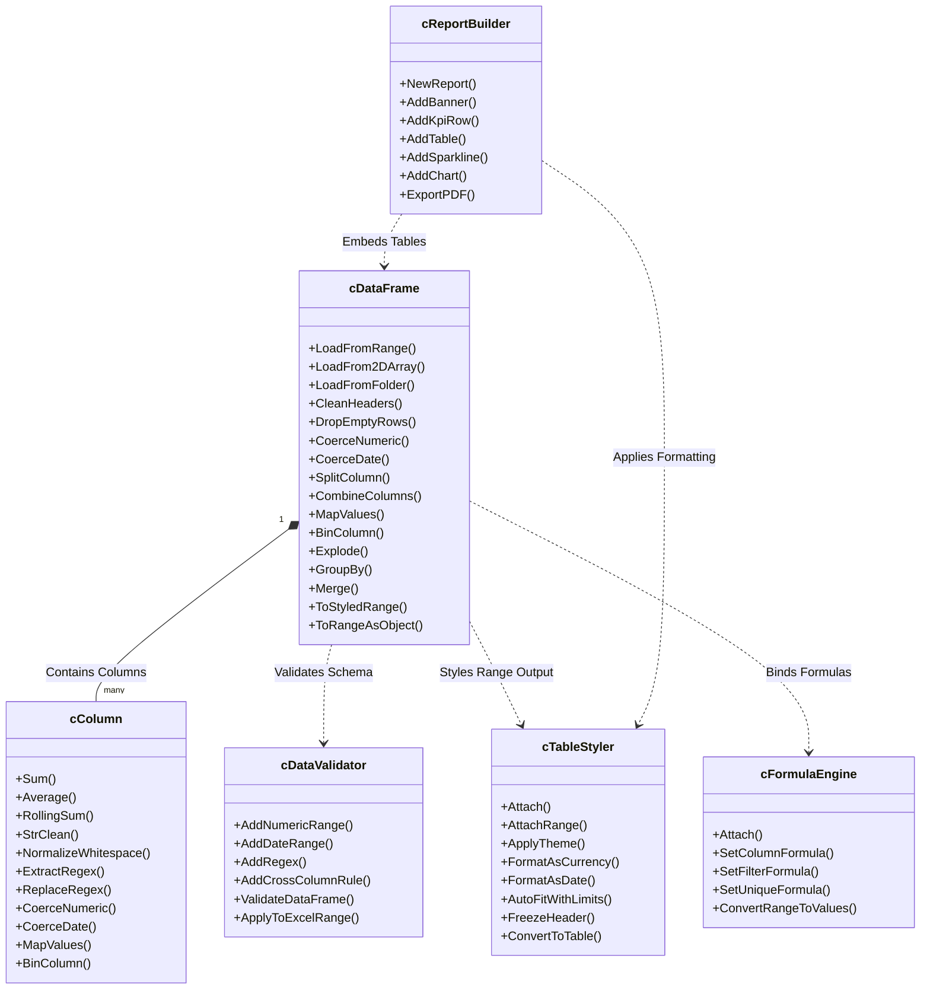

# VBA Columnar Table (cDataFrame) — คู่มือสรุป Function & Object ทั้ง 6 คลาส

คู่มืออ้างอิงฟังก์ชันและคลาสออบเจกต์ (API Reference) ฉบับสมบูรณ์ สำหรับสถาปัตยกรรม Columnar In-Memory DataFrame ใน Excel VBA ประกอบด้วย **6 คลาสหลัก**:

1. [`cDataFrame`](#1-cdataframe-ตารางข้อมูล-2d-columnar-dataframe) — โครงสร้างตาราง 2 มิติ (คล้าย pandas DataFrame)
2. [`cColumn`](#2-ccolumn-เวกเตอร์คอลัมน์-1d-array) — เวกเตอร์ข้อมูล 1 มิติ รองรับ Vectorized Operations, Regex, และ Window Functions
3. [`cTableStyler`](#3-ctablestyler-การจัดสไตล์และฟอร์แมตตารางบน-excel) — จัดรูปแบบ Range และ Table บน Excel แบบ Fluent Chaining
4. [`cDataValidator`](#4-cdatavalidator-การตรวจสอบคุณภาพและความถูกต้องของข้อมูล) — Schema Validation ตรวจสอบกฎความถูกต้องก่อนประมวลผล
5. [`cFormulaEngine`](#5-cformulaengine-การสร้างและตรวจสอบสูตร-excel) — สร้างสูตร Dynamic Array, Structured References และตรวจสอบสูตร
6. [`cReportBuilder`](#6-creportbuilder-การประกอบรายงานและแดชบอร์ดระดับผู้บริหาร) — สร้าง Executive Dashboard, KPI, Sparkline, Multi-Sheet และ PDF

---

## 1. cDataFrame (ตารางข้อมูล 2D Columnar DataFrame)

คลาสตัวแทนตารางข้อมูล 2 มิติที่เก็บข้อมูลแยกตามคอลัมน์ (Column-Oriented Storage) ทำให้การประมวลผลและการรวมกลุ่มเร็วขึ้น 10-100 เท่าเมื่อเทียบกับการวนลูปบนเซลล์ Excel ปกติ

### 1.1 การดึงข้อมูลเข้าตาราง (Get Data)

| เมธอด | ประเภท | คำอธิบาย & การใช้งาน |
| :--- | :--- | :--- |
| `LoadFromRange(SourceRange, [HasHeaders], [FillMerged])` | `Function As cDataFrame` | โหลดข้อมูลจาก Range ใน 1 COM call (รองรับเติมค่า Merged cells อัตโนมัติ) |
| `LoadFrom2DArray(DataArray, [HasHeaders], [Headers])` | `Function As cDataFrame` | โหลดจาก 2D Variant Array ในหน่วยความจำ (รองรับทั้ง 0-based และ 1-based) |
| `LoadFromFolder(FolderPath, [FilePattern], [HasHeaders], [AddSourceColumn], [Recursive], [SheetName])` | `Function As cDataFrame` | รวมไฟล์ CSV/Excel ทั้งหมดในโฟลเดอร์แบบ Power Query (มีคอลัมน์ `SourceFile`) |
| `LoadFromCurrentRegion(AnchorCell, [HasHeaders], [FillMerged])` | `Function As cDataFrame` | อ่านตารางรอบเซลล์ที่ระบุอัตโนมัติ (`AnchorCell.CurrentRegion`) |
| `LoadFromVisibleRange(SourceRange, [HasHeaders])` | `Function As cDataFrame` | อ่านเฉพาะแถวที่มองเห็น (ข้ามแถวที่ถูกซ่อนหรือกรองด้วย AutoFilter) |
| `LoadFromRangeAreas(SourceRange, [HasHeaders], [FillMerged], [AreasRepeatHeaders])` | `Function As cDataFrame` | อ่านและรวมหลายพื้นที่ (`Union Range` / Multi-area) เข้าด้วยกัน |
| `LoadFromRangeText(SourceRange, [HasHeaders])` | `Function As cDataFrame` | อ่านข้อความตามที่แสดงจริง (`Range.Text`) เพื่อเก็บเลข 0 นำหน้าและรูปแบบวันที่ |
| `LoadFromRangeFormulas(SourceRange, [HasHeaders])` | `Function As cDataFrame` | อ่านตัวสูตร (`Range.Formula`) แทนค่าที่คำนวณแล้ว |
| `LoadFromWorkbook(FilePath, [Sheet], [RangeOrTable], [HasHeaders])` | `Function As cDataFrame` | ดึงข้อมูลจากไฟล์ Excel ภายนอก (.xlsx/.xlsm/.xlsb) ทั้งที่เปิดอยู่หรือปิดอยู่ |
| `LoadFromListObject(TableObj)` | `Function As cDataFrame` | ดึงข้อมูลจาก Excel Table (`ListObject`) |
| `LoadFromCSV(FilePath, [Delimiter], [HasHeaders], [AutoInferNumeric])` | `Function As cDataFrame` | อ่านไฟล์ CSV มาตรฐาน RFC 4180 |
| `LoadFromJSON(JsonString)` | `Function As cDataFrame` | แปลง JSON String (`RECORDS` หรือ `SPLIT`) เข้า DataFrame |

```vba
Dim df As New cDataFrame

' 1. โหลดจาก 2D Array
Dim data(1 To 2, 1 To 2) As Variant
data(1, 1) = "Product": data(1, 2) = "Qty"
data(2, 1) = "Widget":  data(2, 2) = 150
df.LoadFrom2DArray data, True

' 2. โหลดทุกไฟล์ CSV ในโฟลเดอร์มารวมกัน
df.LoadFromFolder "C:\Data\MonthlyReports\", "*.csv", True, True

' 3. โหลดเฉพาะแถวที่ผ่าน AutoFilter
df.LoadFromVisibleRange ActiveSheet.Range("A1:D100"), True
```

---

### 1.2 การทำความสะอาดข้อมูล (Clean Data)

| เมธอด | ประเภท | คำอธิบาย & การใช้งาน |
| :--- | :--- | :--- |
| `CleanHeaders([ConvertToLower], [ReplaceSpacesWithUnderscores])` | `Function As cDataFrame` | ล้างชื่อคอลัมน์ ตัดช่องว่าง/ขึ้นบรรทัดใหม่ และป้องกันชื่อซ้ำ |
| `DropEmptyRows([SubsetColumns])` | `Function As cDataFrame` | ลบแถวที่ไม่มีข้อมูล (ว่างทั้งแถว หรือว่างทุกคอลัมน์ใน Subset) |
| `DropEmptyColumns()` | `Function As cDataFrame` | ลบคอลัมน์ที่ไม่มีข้อมูลเลยทิ้งทั้งหมด |
| `PromoteHeaders([RowIndex=1], [CleanNames=True])` | `Function As cDataFrame` | ดันแถวที่ระบุขึ้นเป็นหัวตาราง แล้วตัดแถวด้านบนทิ้ง |
| `CastColumn(ColumnKey, TargetType)` | `Function As cDataFrame` | แปลงชนิดข้อมูลคอลัมน์ (`STRING`, `LONG`, `DOUBLE`, `DATE`, `BOOLEAN`) |
| `CoerceNumeric(ColumnKey, [DefaultVal=0#])` | `Function As cDataFrame` | แปลงข้อความที่ติดลูกน้ำ/สกุลเงิน/วงเล็บติดลบเป็นตัวเลข `Double` |
| `CoerceDate(ColumnKey, [DefaultVal])` | `Function As cDataFrame` | แปลงข้อความวันที่หรือตัวเลข serial เป็นประเภท `Date` |
| `FillNA(FillValue, [SubsetColumns], [TreatBlankStringAsNA])` | `Sub` | แทนที่ค่าว่าง (`Empty`, `Null`, ค่า Error `#N/A`) ด้วยค่าคงที่ |
| `DropNA([SubsetColumns], [How="ANY"], [TreatBlankStringAsNA])` | `Function As cDataFrame` | ลบแถวที่มีค่าว่างทิ้ง (`"ANY"` หรือ `"ALL"`) |
| `DropDuplicates([SubsetColumns], [Keep="FIRST"])` | `Function As cDataFrame` | ลบแถวที่ซ้ำซ้อนตามคอลัมน์ที่กำหนด (`"FIRST"`, `"LAST"`, `"NONE"`) |

```vba
' ล้างหัวตารางและตัดแถวว่าง
df.CleanHeaders ConvertToLower:=True, ReplaceSpacesWithUnderscores:=True
df.DropEmptyRows
df.DropEmptyColumns

' แปลงคอลัมน์ราคาที่เป็นข้อความ "$1,250.50" ให้เป็นตัวเลขคำนวณได้
df.CoerceNumeric "price"
df.CoerceDate "order_date"
```

---

### 1.3 การแปลงและปรับโครงสร้างข้อมูล (Transform Data)

| เมธอด | ประเภท | คำอธิบาย & การใช้งาน |
| :--- | :--- | :--- |
| `SplitColumn(ColumnKey, Delimiter, [NewColPrefix], [MaxSplits], [DropOriginal])` | `Function As cDataFrame` | แยก 1 คอลัมน์เป็นหลายคอลัมน์ย่อยตามตัวคั่น |
| `CombineColumns(ColumnKeys, NewColName, [Separator=" "], [DropOriginals])` | `Function As cDataFrame` | รวมหลายคอลัมน์เข้าเป็น 1 คอลัมน์พร้อมตัวคั่น |
| `MapValues(ColumnKey, MappingDictOrArray, [DefaultVal], [ResultColName])` | `Function As cDataFrame` | แปลงค่าในคอลัมน์ตาม Dictionary/2D Array (Lookup mapping) |
| `BinColumn(ColumnKey, Cutoffs, Labels, [ResultColName])` | `Function As cDataFrame` | จัดกลุ่มตัวเลขเป็นช่วง (Bins) เช่น `Cutoffs=Array(50, 80)`, `Labels=Array("Low","Mid","High")` |
| `Explode(ColumnKey, [Delimiter=","])` | `Function As cDataFrame` | แตกค่าที่มีหลายไอเทมในเซลล์เดียวออกเป็นหลายแถว (Unnest) |
| `Transpose()` | `Function As cDataFrame` | สลับแกนแถวและคอลัมน์ (Pivot Rows to Columns) |
| `Melt(IdVars, ValueVars, [VarName], [ValName])` | `Function As cDataFrame` | Unpivot แปลงตารางแนวกว้าง (Wide) เป็นแนวยาว (Long Format) |
| `Pivot(IndexCol, PivotCol, ValueCol, [AggFunc="SUM"], [FillEmpty=0#])` | `Function As cDataFrame` | ทำ Pivot Table สรุปข้อมูลไขว้สองมิติ |
| `GroupBy(GroupCols, AggCols, AggFuncs)` | `Function As cDataFrame` | จัดกลุ่ม Aggregation (`SUM`, `COUNT`, `AVG`, `MIN`, `MAX`, `MEDIAN`, `STD`, `NUNIQUE`) |
| `Merge(RightTable, [OnKey], [How="INNER"], [LeftOn], [RightOn])` | `Function As cDataFrame` | รวมตาราง (`INNER`, `LEFT`, `RIGHT`, `FULL`, `LEFT_ANTI`, `LEFT_SEMI`, `CROSS`) |
| `NLargest(N, ColumnKey)` / `NSmallest(N, ColumnKey)` | `Function As cDataFrame` | คัดเลือก N แถวแรกที่มีค่าสูงสุดหรือต่ำสุด |
| `Sample(N, [Seed=-1])` | `Function As cDataFrame` | สุ่มตัวอย่าง N แถวแบบ Fisher-Yates shuffle |

```vba
' 1. แยกชื่อ-นามสกุล และรวมรหัสแผนก
df.SplitColumn "full_name", " ", "name"
df.CombineColumns Array("dept_code", "sub_dept"), "full_dept", "-"

' 2. แมปเพศ M -> Male, F -> Female
Dim dSex As Object: Set dSex = CreateObject("Scripting.Dictionary")
dSex("M") = "Male": dSex("F") = "Female"
df.MapValues "gender", dSex, "Other"

' 3. แตกสกิลการทำงานที่คั่นด้วย comma ออกเป็นคนละแถว
Dim dfSkills As cDataFrame
Set dfSkills = df.Explode("skills", ",")
```

---

### 1.4 การเขียนข้อมูลลง Excel Range & Export

| เมธอด | ประเภท | คำอธิบาย & การใช้งาน |
| :--- | :--- | :--- |
| `ToRange(TargetCell, [IncludeHeaders])` | `Sub` | เขียนข้อมูลทั้งหมดลง Excel Worksheet ใน 1 COM write |
| `ToRangeAsObject(TargetCell, [IncludeHeaders])` | `Function As Object` | เขียนลง Sheet และคืนค่า Range ออบเจกต์ปลายทางกลับมา |
| `ToRangeReplace(TargetCell, [IncludeHeaders], [ClearBelow], [ClearRight])` | `Function As Object` | เขียนทับตารางเดิมและล้างข้อมูลเก่าด้านล่าง/ด้านขวาที่เกินออก |
| `AppendToRange(AnchorCell, [IncludeHeadersIfEmpty])` | `Function As Object` | ต่อท้ายแถวใหม่ใต้ตารางเดิมบน Sheet อัตโนมัติ |
| `ToRangeChunked(TargetCell, [IncludeHeaders], [ChunkSize=5000])` | `Function As Object` | ทยอยเขียนข้อมูลขนาดใหญ่ทีละก้อน ป้องกัน Excel ค้าง |
| `To2DArray([IncludeHeaders=True])` | `Function As Variant` | ดึงข้อมูลทั้งหมดออกมาเป็น 2D Variant Array ใน RAM |
| `ToStyledRange(TargetCell, [ThemeName="NAVY"])` | `Function As cTableStyler` | เขียนข้อมูลและสร้าง `cTableStyler` ผูกไว้พร้อมจัดธีมทันที |
| `ToListObject(TargetCellOrSheet, [TableName])` | `Function As Object` | เขียนเป็น Excel Table (`ListObject`) |
| `ToCSV(FilePath, [Delimiter], [IncludeHeaders], [SanitizeFormulas])` | `Sub` | เซฟเป็นไฟล์ CSV พร้อมป้องกัน Formula Injection |
| `ToJSON([Orient="RECORDS"])` | `Function As String` | แปลงเป็น JSON String |
| `ToMarkdown([MaxRows])` / `ToHTML([TableClass])` | `Function As String` | แปลงเป็นตาราง Markdown หรือ HTML |

---

## 2. cColumn (เวกเตอร์คอลัมน์ 1D Array)

คลาสตัวแทนคอลัมน์ข้อมูลเดี่ยว จัดเก็บข้อมูลแบบ Contiguous 1D SafeArray รองรับการคำนวณแบบ Vectorized Operation:

### 2.1 สถิติและการวิเคราะห์เชิงตัวเลข

| เมธอด | คำอธิบาย |
| :--- | :--- |
| `Sum()`, `Average()`, `Min()`, `Max()` | คำนวณผลรวม, ค่าเฉลี่ย, ค่าน้อยสุด, ค่ามากสุด |
| `Median()`, `Quantile(q)` | คำนวณมัธยฐาน และเปอร์เซ็นไทล์ ($0.0 \le q \le 1.0$) |
| `Variance()`, `StdDev()` | คำนวณความแปรปรวน และส่วนเบี่ยงเบนมาตรฐาน |
| `NUnique()` / `Unique()` | นับจำนวนค่าที่ไม่ซ้ำ หรือดึงเวกเตอร์ค่าที่ไม่ซ้ำออกมา |
| `ValueCounts()` | สรุปความถี่ของแต่ละค่า (คืนค่าเป็น DataFrame แสดง Value และ Count) |
| `RollingSum(WindowSize)`, `RollingAvg(WindowSize)` | ผลรวมและค่าเฉลี่ยเคลื่อนที่แบบ $O(N)$ Sliding Window |
| `CumSum()`, `Shift(Periods)`, `PctChange(Periods)`, `Rank()` | ผลรวมสะสม, เลื่อนแถว (Lag/Lead), เปอร์เซ็นต์การเติบโต, และการจัดอันดับ |
| `AbsCol()`, `RoundCol([Decimals=0])` | ค่าสัมบูรณ์ และการปัดเศษทศนิยม |

### 2.2 ข้อความและการจัดการตัวอักษร (String & Regex)

| เมธอด | คำอธิบาย |
| :--- | :--- |
| `StrClean([ResultName])` | ลบ ASCII Control Characters (`Chr(0)..Chr(31)`, `Chr(127)`) และแก้อักขระ Non-breaking space |
| `NormalizeWhitespace([ResultName])` | แปลงแท็บ/ขึ้นบรรทัดใหม่เป็นช่องว่าง ยุบช่องว่างซ้ำ และตัดหัวท้าย |
| `StrTrim()`, `StrUpper()`, `StrLower()`, `StrReplace(Find, Replace)` | ตัดช่องว่าง, พิมพ์ใหญ่, พิมพ์เล็ก, แทนที่คำ |
| `StrContains(Substr, [IgnoreCase=True])` | คืนเวกเตอร์ Boolean ตรวจสอบว่ามีคำที่ค้นหาอยู่ในเซลล์หรือไม่ |
| `StrLen([ResultName])` | คืนเวกเตอร์ความยาวตัวอักษรของแต่ละแถว |
| `ExtractRegex(Pattern, [GroupIndex=0])` | ดึงข้อความตาม Regex Pattern หรือ Capture Group ผ่าน `VBScript.RegExp` |
| `ReplaceRegex(Pattern, Replacement)` | แทนที่ข้อความด้วย Regex Pattern ทั้งหมด |

### 2.3 การแปลงชนิดข้อมูลและการเติมค่า (Coercion & Imputation)

| เมธอด | คำอธิบาย |
| :--- | :--- |
| `Cast(TargetType)` | แปลงประเภทเป็น `STRING`, `LONG`, `DOUBLE`, `DATE`, หรือ `BOOLEAN` |
| `CoerceNumeric([ResultName], [DefaultVal=0#])` | แปลงสตริงตัวเลขที่มี `$`, `฿`, `,`, `%`, หรือ `(100)` เป็น Double |
| `CoerceDate([ResultName], [DefaultVal])` | แปลงสตริง `YYYY-MM-DD` หรือเลข serial เป็น Date |
| `FFill()` / `BFill()` | เติมค่าว่างด้วยค่าแถวก่อนหน้า (Forward-fill) หรือค่าแถวถัดไป (Backward-fill) |
| `IsNA()` | คืนเวกเตอร์ Boolean ว่าแถวใดมีค่าว่าง (`Empty`, `Null`, `Error`) |
| `IsIn(ValuesListOrArray)` | คืนเวกเตอร์ Boolean ว่าค่าในแถวอยู่ในรายการที่ระบุหรือไม่ |
| `MapValues(MappingDictOrArray, [DefaultVal])` | แปลงค่าตาม Dictionary หรือ 2D Array |
| `BinColumn(Cutoffs, Labels)` | แบ่งช่วงตัวเลขเป็นกลุ่มข้อความ |

---

## 3. cTableStyler (การจัดสไตล์และฟอร์แมตตารางบน Excel)

คลาสตกแต่งตารางและจัดฟอร์แมตเซลล์บน Excel Worksheet ด้วยเทคนิค Bulk COM Properties:

| เมธอด | พารามิเตอร์ & รูปแบบ | คำอธิบาย |
| :--- | :--- | :--- |
| `Attach(TopLeftCell, DataFrame, [HasHeaders])` | `Range, cDataFrame` | ผูก Styler เข้ากับตาราง DataFrame บนแผ่นงาน |
| `AttachRange(SourceRange, [HasHeaders])` | `Range` | ผูก Styler เข้ากับ Range ใดๆ บนชีตโดยตรง (ไม่ต้องมี DataFrame) |
| `ApplyTheme([ThemeName="NAVY"])` | `"NAVY"`, `"SLATE"`, `"EMERALD"`, `"MINIMAL"` | เปลี่ยนชุดสีตารางและฟอนต์มาตรฐาน |
| `FormatColumn(ColumnKey, FormatString)` | `ColKey, NumberFormat` | กำหนดรูปแบบตัวเลข เช่น `"$#,##0.00"`, `"0.0%"` |
| `FormatAsCurrency(ColumnKeyOrPattern, [CurrencySymbol="$"])` | `ColKey, CurrencySymbol` | ฟอร์แมตสกุลเงินแบบอัตโนมัติ |
| `FormatAsPercent(ColumnKeyOrPattern, [Decimals=1])` | `ColKey, Decimals` | ฟอร์แมตเปอร์เซ็นต์แบบอัตโนมัติ |
| `FormatAsDate(ColumnKeyOrPattern, [DateFormat="yyyy-mm-dd"])` | `ColKey, DateFormat` | ฟอร์แมตวันที่แบบอัตโนมัติ |
| `ApplyBorders([BorderColor])` | `BorderColor (RGB)` | ตีเส้นขอบตารางสีเทาแบบบาง |
| `ApplyZebraStripes([StripeColor])` | `StripeColor (RGB)` | ทำสีพื้นหลังสลับแถวให้อ่านง่าย |
| `HighlightTotalRow([TopBorder], [DoubleBottom])` | `Boolean` | ทำแถวสุดท้ายเป็นแถวสรุปยอด (ตัวหนา + เส้นคู่) |
| `HighlightDuplicates(ColumnKeyOrPattern)` | `ColKey` | ไฮไลต์ข้อมูลที่ซ้ำกันด้วย Conditional Formatting |
| `HighlightBlanks(ColumnKeyOrPattern)` | `ColKey` | ไฮไลต์เซลล์ที่ว่างในคอลัมน์ที่กำหนด |
| `ApplyIconSets(ColumnKeyOrPattern, [IconSetId=4])` | `ColKey, IconSetId` | ใส่ไอคอนไฟจราจรหรือลูกศร (KPI Icon Sets) |
| `AutoFitWithLimits([MinWidth=8], [MaxWidth=45])` | `MinWidth, MaxWidth` | ปรับความกว้างคอลัมน์อัตโนมัติโดยจำกัดขอบเขตไม่ให้ล้นจอ |
| `FreezeHeader([FreezeColumns=0])` | `FreezeColumns` | ตรึงแถวหัวตาราง (และคอลัมน์ซ้าย) ไว้ตลอดการเลื่อนจอ |
| `ConvertToTable([TableName], [TableStyle])` | `TableName, TableStyle` | แปลงพื้นที่ตารางเป็นโครงสร้าง Excel Table (`ListObject`) |
| `ClearFormats()` | - | ล้างการจัดฟอร์แมตทั้งหมดออกจากพื้นที่ตาราง |

```vba
Dim sty As New cTableStyler
sty.AttachRange ActiveSheet.Range("A1:E50"), True
sty.ApplyTheme "SLATE"
sty.FormatAsCurrency "Salary", "฿"
sty.FormatAsDate "HireDate", "dd/mm/yyyy"
sty.HighlightDuplicates "Email"
sty.AutoFitWithLimits 10, 35
sty.FreezeHeader
```

---

## 4. cDataValidator (การตรวจสอบคุณภาพและความถูกต้องของข้อมูล)

คลาสตรวจสอบคุณภาพข้อมูล (Data Quality Assurance) ก่อนนำเข้าสู่ขั้นตอนการคำนวณ:

| เมธอด | พารามิเตอร์ | คำอธิบาย |
| :--- | :--- | :--- |
| `AddNumericRange(Col, MinVal, MaxVal, [AllowNull])` | ขอบเขตตัวเลข | ตรวจสอบว่าตัวเลขอยู่ในช่วงที่กำหนด |
| `AddDateRange(Col, MinDate, MaxDate, [AllowNull])` | ขอบเขตวันที่ | ตรวจสอบว่าวันที่ไม่เกินงวดที่กำหนด |
| `AddList(Col, AllowedValues, [AllowNull])` | รายการที่อนุญาต | ตรวจสอบว่าค่าในเซลล์อยู่ใน Allowed List |
| `AddStringLength(Col, MinLen, MaxLen, [AllowNull])` | ความยาวสตริง | ตรวจสอบความยาวตัวอักษร เช่น รหัสบัตร/เบอร์โทร |
| `AddRegex(Col, Pattern, [AllowNull])` | รูปแบบ Regex | ตรวจสอบรูปแบบอีเมลหรือรหัสเอกสาร |
| `AddCrossColumnRule(RuleName, Expression)` | นิพจน์เปรียบเทียบ | ตรวจสอบเงื่อนไขข้ามคอลัมน์ (เช่น `EndDate >= StartDate`) |
| `ValidateDataFrame(DataFrame)` | `cDataFrame` | รันการตรวจสอบทั้งหมด คืนค่า `True` หากข้อมูลผ่านทุกกฎ |
| `ErrorCount` / `Errors` | - | คืนจำนวนข้อผิดพลาดและตารางรายละเอียด Error ที่พบ |
| `ApplyToExcelRange(TargetRange)` | `Excel.Range` | นำกฎไปผูกเป็น Excel Data Validation (Dropdown / Alert) บนชีต |

```vba
Dim val As New cDataValidator
val.AddNumericRange "Price", 0#, 1000000#
val.AddDateRange "OrderDate", #1/1/2026#, #12/31/2026#
val.AddRegex "Email", "^[A-Za-z0-9._%+-]+@[A-Za-z0-9.-]+\.[A-Za-z]{2,}$"
val.AddCrossColumnRule "ShipAfterOrder", "ShipDate >= OrderDate"

If Not val.ValidateDataFrame(df) Then
    MsgBox "พบข้อมูลผิดพลาด " & val.ErrorCount & " รายการ!", vbExclamation
End If
```

---

## 5. cFormulaEngine (การสร้างและตรวจสอบสูตร Excel)

คลาสสร้างและตรวจสอบสูตรการคำนวณขั้นสูงของ Excel แบบปลอดภัย:

| เมธอด | พารามิเตอร์ | คำอธิบาย |
| :--- | :--- | :--- |
| `Attach(TargetRangeOrSheet, [DataBodyRange])` | `Range/Sheet` | ผูกตัวคำนวณเข้ากับช่วงตารางบน Excel |
| `SetColumnFormula(Col, FormulaTemplate, [R1C1])` | สูตรคอลัมน์ | กำหนดสูตรให้ทั้งคอลัมน์ (รองรับ Token `[ColName]`) |
| `SetColumnFormulaArrayLong(Col, Formula)` | สูตรอาร์เรย์ยาว | ใส่สูตร CSE Array Formula ที่มีความยาวเกิน 255 ตัวอักษร |
| `SetFilterFormula(AnchorCell, IncludeCond, ...)` | สูตร Dynamic Array | สร้างสูตร `=FILTER(...)` พร้อม Anchor cell |
| `SetUniqueFormula(AnchorCell, ColOrRange)` | สูตร Dynamic Array | สร้างสูตร `=UNIQUE(...)` แบบหกกระจาย (Spill) |
| `SetSortFormula(AnchorCell, ColOrRange, ...)` | สูตร Dynamic Array | สร้างสูตร `=SORT(...)` อัตโนมัติ |
| `ValidateFormulaSyntax(FormulaStr)` | `String` | ตรวจสอบไวยากรณ์สูตรว่าวงเล็บเปิดปิดสมดุลและเครื่องหมายถูกต้อง |
| `ConvertRangeToValues(TargetRange)` | `Range` | แปลงช่วงสูตรให้เป็นค่าคงที่ (Paste Values) โดยไม่ผ่าน Clipboard |
| `AuditFormulaInconsistency([ColKey])` | `ColKey` | ตรวจหาเซลล์ที่มีสูตรคำนวณต่างจากเพื่อนร่วมคอลัมน์ |
| `ConvertFormulaReferences(Mode)` | `"A1"` หรือ `"R1C1"` | แปลงสูตรสลับระหว่างรูปแบบ A1 และ R1C1 |

```vba
Dim fe As New cFormulaEngine
fe.Attach ActiveSheet.Range("A1:F100")
fe.SetColumnFormula "GrossAmount", "=[Qty]*[UnitPrice]"
fe.SetFilterFormula "H2", "Total", ">", 1000
fe.ConvertRangeToValues ActiveSheet.Range("D2:D100")
```

---

## 6. cReportBuilder (การประกอบรายงานและแดชบอร์ดระดับผู้บริหาร)

คลาสประกอบชิ้นส่วนรายงานแบบ Fluent Builder ช่วยสร้างชีตแดชบอร์ดที่สมบูรณ์แบบได้ในคำสั่งเดียว:

| เมธอด | คำอธิบาย |
| :--- | :--- |
| `NewReport(TargetSheet, [ReportTitle])` | เริ่มต้นสร้างหน้าเอกสารรายงานใหม่ |
| `AddBanner(Title, [Subtitle], [ThemeName])` | ใส่แบนเนอร์ส่วนหัวรายงานพร้อมชื่อและสไตล์องค์กร |
| `AddKpiRow(Labels, Values, [FormatStrings])` | สร้างการ์ดสรุปตัวชี้วัด (KPI Cards) 3-5 การ์ดเรียงแนวนอน |
| `AddSectionHeader(Title, [Subtitle])` | ใส่แถบหัวข้อแบ่งหมวดหมู่รายงาน |
| `AddTable(DataFrame, [ThemeName], [AutoFit])` | วางตาราง DataFrame พร้อมจัดรูปแบบอัตโนมัติ |
| `AddFormulaColumn(ColName, FormulaTemplate)` | เพิ่มคอลัมน์สูตรคำนวณต่อท้ายตารางรายงาน |
| `AddSparkline(SourceRange, TargetCell, [SparkType])` | วาดกราฟเส้น/แท่งประกายมินิ (Sparkline) ในเซลล์ |
| `AddChart([SourceRange], [ChartType], ...)` | สร้างกราฟขนาดมาตรฐาน (Column, Line, Pie, Bar) |
| `AddImage(ImagePath, [Left], [Top], [Width], [Height])` | แทรกโลโก้หรือรูปภาพประกอบรายงาน |
| `BuildMultiSheetReport(DataFrame, SplitCol, ...)` | แตกตารางแยกออกเป็นรายแผ่นงานตามกลุ่มข้อมูลอัตโนมัติ |
| `ExportPDF(FilePath, [Orientation])` | แปลงชีตรายงานเป็นเอกสารไฟล์ PDF พร้อมตั้งค่าหน้ากระดาษ |

```vba
Dim rb As New cReportBuilder
rb.NewReport ActiveSheet, "Executive Monthly Sales Dashboard" _
  .AddBanner("Executive Monthly Performance", "Generated: " & Format$(Date, "yyyy-mm-dd"), "NAVY") _
  .AddKpiRow(Array("Total Revenue", "Avg Margin", "Active Clients"), _
             Array(1450000#, 0.285, 120), _
             Array("$#,##0", "0.0%", "#,##0")) _
  .AddSectionHeader("Detailed Regional Breakdown") _
  .AddTable(dfRegionalSummary, "NAVY", True) _
  .AddSparkline("C8:N8", "O8", "LINE") _
  .ExportPDF "C:\Reports\Monthly_Dashboard.pdf"
```

---

## 7. ตัวอย่างกระบวนการทำงานครบวงจร (End-to-End Pipeline)

```vba
Public Sub RunSalesPipeline()
    Dim df As New cDataFrame

    ' 1. ดึงข้อมูล (Get Data)
    df.LoadFromFolder "C:\Data\DailySales\", "*.csv", HasHeaders:=True

    ' 2. ทำความสะอาดข้อมูล (Clean Data)
    df.CleanHeaders ConvertToLower:=True, ReplaceSpacesWithUnderscores:=True
    df.DropEmptyRows
    df.CoerceNumeric "revenue"
    df.CoerceDate "order_date"

    ' 3. แปลงข้อมูล (Transform Data)
    df.SplitColumn "customer_name", " ", "cust"
    df.BinColumn "revenue", Array(1000, 5000), Array("Bronze", "Silver", "Gold"), "tier"

    ' 4. สรุปผลด้วย GroupBy
    Dim dfSummary As cDataFrame
    Set dfSummary = df.GroupBy(Array("region", "tier"), Array("revenue", "revenue"), Array("SUM", "COUNT"))

    ' 5. แสดงผลบน Excel และจัดสไตล์ (Style & Report)
    Dim ws As Worksheet
    Set ws = ThisWorkbook.Worksheets.Add
    Dim styler As cTableStyler
    Set styler = dfSummary.ToStyledRange(ws.Range("B5"), "NAVY")
    styler.FormatAsCurrency "revenue_SUM", "$"
    styler.AutoFitWithLimits 12, 35
    styler.FreezeHeader
End Sub
```

---

## 8. แผนภาพความสัมพันธ์ของทั้ง 6 คลาส (Architecture Diagram)



---

## 9. สรุปผลการทดสอบประสิทธิภาพ (Benchmark Summary)

จากการทดสอบ Automated Live Excel COM Test Suite จำนวน **966 รายการ** บน Microsoft Excel 16.0 COM:

| การทำงาน | ปริมาณข้อมูล | เวลาเฉลี่ยที่ใช้ |
| :--- | :--- | :--- |
| สร้างตารางและใส่ข้อมูล 10,000 แถว $\times$ 5 คอลัมน์ | 10,000 แถว | **0.063 วินาที** |
| คำนวณผลรวมเวกเตอร์ (`cColumn.Sum`) | 10,000 แถว | **< 0.001 วินาที** |
| เรียงลำดับ QuickSort หลายคอลัมน์ใน RAM | 10,000 แถว | **0.210 วินาที** |
| ค้นหาค่าแบบ O(1) Hash Key (`df.Loc`) | 10,000 แถว | **0.000000 วินาที** ($O(1)$) |
| รัน GroupBy Hash Aggregation (100 กลุ่ม) | 10,000 แถว | **0.078 วินาที** |
| ทดสอบครบ 47 ชุดหมวดหมู่ฟังก์ชัน (**966 assertions**) | ทุกคลาส | **5.699 วินาที** (100% PASS) |
