# VBA Columnar Table (VBA DataFrame Prototype)

> High-performance Column-Oriented In-Memory Table Architecture for Microsoft Excel VBA.  
> Primary Maintainer: Korn (Backend Developer) · Architecture Governance: Kit (Tech Lead) · QA & Verification: Ta (QA Engineer).  
> **คู่มืออ้างอิง API & วิธีใช้ออบเจกต์ทั้ง 6 คลาสฉบับเต็ม:** ดูได้ที่ [API-REFERENCE.md](API-REFERENCE.md) (ครอบคลุม Get Data, Clean, Transform, Validate, Formula, Report พร้อมตัวอย่างโค้ด)

---

## 1. Overview

Traditional VBA data handling commonly relies on standard 2D Variant arrays (`Dim arr(1 To N, 1 To M)`). While 2D arrays offer fast bulk read/write to Excel worksheets, they suffer from severe architectural limitations:

1. **Costly Column Operations**: Adding, dropping, or renaming columns requires reallocating an entire $N \times M$ 2D matrix ($O(N \times M)$ memory copy) because VBA's native `ReDim Preserve` can only resize the **last** dimension.
2. **Buffer Inefficiency**: Resizing row buffers without geometric growth leads to quadratic $O(N^2)$ reallocation costs.
3. **No Named Indexing**: Column lookups require manual numeric tracking (`arr(r, 4)` vs `df(r, "Total")`).
4. **Slow Searches & Merges**: VLOOKUP / nested loop joins on 2D arrays exhibit $O(N \times M)$ performance.

**`vba-columnar-table` (Option A: Column-Oriented Store / VBA DataFrame)** solves these challenges by storing tabular data as independent 1D column vectors managed by a case-insensitive dictionary:

- **$O(1)$ Column Add / Drop / Rename**: In-place dictionary operations without copying data rows.
- **Amortized $O(1)$ Row Appends & Bulk 2D Appends (`AddRows`)**: Geometric buffer expansion ($2\times$ factor) using native 1D `ReDim Preserve`, plus `AddRows(Source2DArray)` that pre-allocates column buffers upfront and copies 1-based or 0-based 2D arrays in tight column-major loops without dictionary lookups.
- **$O(1)$ Single & Multi-Column Composite Matrix Indexing (`SetIndex` / `Loc`)**: `SetIndex` accepts a single column key or a 1D `Array(...)` of composite keys (joined with `Chr$(30)`), enabling instant 2-way matrix cell access and mutation via `df.Loc(RowKeyOrArray, ColKey)` and `df.HasIndexKey(RowKeyOrArray)`.
- **In-Memory Multi-Column QuickSort**: Indirect permutation of 1D column buffers with multi-column asc/desc keys and stable tie-breaking.
- **$O(N + M)$ Relational & Anti-Joins (`Merge`)**: Supports single or multi-column join keys across `"INNER"`, `"LEFT"`, `"RIGHT"`, `"FULL"`, `"LEFT_ANTI"`, and `"LEFT_SEMI"` joins with automated column collision handling (`_left`, `_right`).
- **$O(N)$ Hash GroupBy & Pivot (`GroupBy` / `Pivot`)**: Two-pass dictionary hash grouping supporting single/multi-column keys, multi-function aggregations (`SUM`, `COUNT`, `AVG`/`AVERAGE`, `MIN`, `MAX`), and cross-tabulation pivot tables with automatic $O(1)$ `Loc` row indexing.
- **$O(N)$ Deduplication & Vertical Union (`Unique`, `DropDuplicates`, `Concat`)**: Fast dictionary-backed column distinct extraction, multi-column row deduplication (`Keep:="FIRST"`, `"LAST"`, `"NONE"`), and vertical `UNION ALL` concatenation with optional schema superset expansion.
- **Zero-Friction Range, ListObject & CSV I/O (with Formula Injection Protection)**: Single COM read/write (`LoadFromRange`, `ToRange`), structured Excel Table integration (`LoadFromListObject`, `ToListObject` safely ignoring `TotalsRowRange`), and worksheet-free RFC 4180 CSV file I/O (`LoadFromCSV`, `ToCSV` with optional `SanitizeFormulas:=True` to neutralize `=`, `+`, `-`, `@`, `vbTab`, `vbCr` payloads).
- **Vectorized Math & Column Arithmetic**: Built-in `Sum`, `Average`, `Min`, `Max`, plus element-wise `VectorOp` (`Add`, `Subtract`, `Multiply`, `Divide`) against scalars, `cColumn` vectors, or 1D arrays with safe `#DIV/0!` (`CVErr(2007)`) and `Empty` propagation.
- **Missing Data Cleaning (`FillNA`, `DropNA`)**: In-place missing value imputation (`Empty`, `Null`, `Error`, and optional blank strings) and fast $O(N)$ row filtering (`How:="ANY"` or `"ALL"`).
- **Window & Cumulative Functions (`CumSum`, `Shift`, `PctChange`, `Rank`)**: Running totals, lag/lead period offsets, period-over-period growth rates, and $O(N \log N)$ tie-aware ranking (`"AVERAGE"`, `"MIN"`, `"DENSE"`).
- **Slicing, Column Projection & Vectorized String/Conditional Ops**: `Head`, `Tail`, `Slice`, `SelectColumns`, `Where` (vectorized ternary `IIf`), `Clip`, and `StrTrim` / `StrUpper` / `StrLower` / `StrReplace`.
- **Decoupled Excel Cell & Range Styling (`cTableStyler`)**: Clean separation of concerns between tabular data manipulation and Excel presentation. Provides a fluent method-chaining API (`Attach`, `ApplyTheme`, `FormatColumn`/`FormatColumns`, `AlignColumn`, `ApplyBorders`, `ApplyZebraStripes`, `HighlightTotalRow`, `AutoFitColumns`, `SetHeaderRowHeight`, `SetDataRowHeight`, `SetColumnWidth`, `SetUniformColumnWidth`, `SetSectionRowHeight`, `HighlightValues`, `FreezePanes`, `SetFont`, `SetGridlines`) with single-COM-call bulk styling, vectorized formatting, and conditional formatting.
- **Vectorized Date/Time, Compound Filter, Unpivot (`Melt`) & JSON Serialization**: Built-in `Year`, `Month`, `Day`, `Quarter`, `DayOfWeek`, `DateAdd`, `DateDiff`, `FormatDate`, `TryParseExcelDate` (handling native Dates, strings, and `.Value2` serial numbers), `BuildCalendarMatrix`, short-circuit `FilterCompound` (`AND`/`OR`), wide-to-tall `Melt`, and zero-dependency `ToJSON` / `LoadFromJSON` (`RECORDS` & `SPLIT`).
- **Executive Report Composer & Weekly Calendar Grids (`cReportBuilder` & `cTableStyler`)**: Fluent dashboard composition (`AddBanner`, `AddKpiRow`, `AddSectionHeader`, `AddQuickJumpBar`, `AddActionButton`, `AddTable`, `AddProvenanceFooter`) paired with `ApplyColumnGroupBanner`, `ApplyColumnGroupGrid`, `ApplyWeeklyCalendarGrid`, `SpotlightColumn`, and `DimColumns`.

---

## 2. Architecture Diagram

```mermaid
classDiagram
    class cDataFrame {
        -mCols: Scripting.Dictionary
        -mRowCount: Long
        -mRowIndexMap: Scripting.Dictionary
        -mIndexColumnName: String
        -mIndexDirty: Boolean
        +RowCount: Long
        +ColumnCount: Long
        +IndexColumnName: String
        +Item(RowIndex, ColumnKey): Variant (Default)
        +Loc(RowKey, ColumnKey): Variant (Get/Let/Set)
        +Lookup(RowKeyValue, KeyColumn, TargetColumn): Variant
        +SetIndex(ColumnNameOrArray, SkipEmptyKeys): void
        +HasIndexKey(RowKey): Boolean
        +AddColumn(Name, DefaultValue, Array1D): cColumn
        +DropColumn(ColumnKey): void
        +RenameColumn(OldName, NewName): void
        +ReorderColumns(NewOrderArray): void
        +HasColumn(ColumnKey): Boolean
        +Column(ColumnKey): cColumn
        +ColumnNames(): String[]
        +AddRow(Values...): Long
        +AddRows(Source2DArray): Long
        +InsertRow(TargetIndex, Values...): void
        +DeleteRow(TargetIndex): void
        +Sort(SortColumns, Ascending): void
        +Merge(RightTable, OnKey, How): cDataFrame
        +GroupBy(GroupColumns, AggColumns, AggFuncs): cDataFrame
        +Pivot(IndexColumn, PivotColumn, ValueColumn, AggFunc, FillEmpty): cDataFrame
        +Describe(): cDataFrame
        +Corr(): cDataFrame
        +Eval(Expression, ResultName): cColumn
        +ToMarkdown(MaxRows): String
        +ToHTML(TableClass, IncludeCSS): String
        +LoadFromWorkbook(FilePath, Sheet, RangeOrTable, HasHeaders): cDataFrame
        +LoadFromRange(SourceRange, HasHeaders): cDataFrame
        +ToRange(TargetCell, IncludeHeaders): void
        +LoadFromListObject(TableObj): cDataFrame
        +ToListObject(TargetCellOrSheet, TableName): ListObject
        +LoadFromCSV(FilePath, Delimiter, HasHeaders, AutoInferNumeric): cDataFrame
        +ToCSV(FilePath, Delimiter, IncludeHeaders): void
        +Filter(ColumnName, Operator, CompareValue): cDataFrame
        +FilterCompound(Conditions, Logic): cDataFrame
        +Melt(IdVars, ValueVars, VarName, ValName): cDataFrame
        +ToJSON(Orient): String
        +LoadFromJSON(JsonString): cDataFrame
        +Head(N): cDataFrame
        +Tail(N): cDataFrame
        +Slice(FromRow, ToRow): cDataFrame
        +SelectColumns(ColumnKeys): cDataFrame
        +Where(ColumnName, Operator, CompareValue, TrueValue, FalseValue, ResultColName): cColumn
        +DropDuplicates(SubsetColumns, Keep): cDataFrame
        +Concat(OtherTable, AllowMissingColumns): cDataFrame
        +FillNA(FillValue, SubsetColumns, TreatBlankStringAsNA): void
        +DropNA(SubsetColumns, How, TreatBlankStringAsNA): cDataFrame
        +TryParseExcelDate(Value, OutDate): Boolean
        +BuildCalendarMatrix(DateColumn, RowKeyColumn, YearVal, MonthVal, ExtraRowColumns, MasterRowsDf, MasterKeyColumn, FixedMaxDays): cDataFrame
        +Clone(StructureOnly): cDataFrame
    }

    class cColumn {
        -mName: String
        -mData(): Variant (1 To mCapacity)
        -mCount: Long
        -mCapacity: Long
        +Name: String
        +Count: Long
        +Capacity: Long
        +Item(RowIndex): Variant (Default)
        +EnsureCapacity(RequiredCapacity): void
        +SetCount(NewCount, DefaultValue): void
        +Append(Value): void
        +ShiftDown(FromIndex): void
        +ShiftUp(FromIndex): void
        +Fill(Value, FromRow, ToRow): void
        +Permute(indices()): void
        +Find(Value, StartIndex): Long
        +ToArray(): Variant[]
        +LoadFromArray(SourceArray): void
        +Sum(): Double
        +Average(): Double
        +Median(): Double
        +Quantile(q): Double
        +Variance(sample): Double
        +StdDev(sample): Double
        +Mode(): Variant
        +Covariance(OtherCol, Sample): Double
        +Correlation(OtherCol): Double
        +RollingSum(WindowSize): cColumn
        +RollingAvg(WindowSize): cColumn
        +RollingMin(WindowSize): cColumn
        +RollingMax(WindowSize): cColumn
        +Min(): Variant
        +Max(): Variant
        +FillNA(FillValue, TreatBlankStringAsNA): void
        +VectorOp(Operator, Operand, ResultName): cColumn
        +Add(Operand, ResultName): cColumn
        +Subtract(Operand, ResultName): cColumn
        +Multiply(Operand, ResultName): cColumn
        +Divide(Operand, ResultName): cColumn
        +CumSum(ResultName): cColumn
        +Shift(Periods, FillValue, ResultName): cColumn
        +PctChange(Periods, FillValue, ResultName): cColumn
        +Rank(Ascending, Method, ResultName): cColumn
        +StrTrim(ResultName): cColumn
        +StrUpper(ResultName): cColumn
        +StrLower(ResultName): cColumn
        +StrReplace(FindStr, ReplaceWith, ResultName, IgnoreCase): cColumn
        +Clip(Lower, Upper, ResultName): cColumn
        +Year(ResultName): cColumn
        +Month(ResultName): cColumn
        +Day(ResultName): cColumn
        +Quarter(ResultName): cColumn
        +DayOfWeek(FirstDayOfWeek, ResultName): cColumn
        +DateAdd(Interval, Number, ResultName): cColumn
        +DateDiff(Interval, OtherDateOrCol, ResultName): cColumn
        +FormatDate(FormatString, ResultName): cColumn
        +Unique(): cColumn
        +Clone(): cColumn
    }

    class cTableStyler {
        -mTopLeftCell: Object
        -mWorksheet: Object
        -mRowCount: Long
        -mColumnCount: Long
        -mHasHeaders: Boolean
        -mColIndexMap: Scripting.Dictionary
        -mTableRange: Object
        -mHeaderRange: Object
        -mDataBodyRange: Object
        +TableRange: Object
        +HeaderRange: Object
        +DataBodyRange: Object
        +TopLeftCell: Object
        +Worksheet: Object
        +RowCount: Long
        +ColumnCount: Long
        +HasHeaders: Boolean
        +Attach(TargetRangeOrTopLeft, SourceDataFrame, HasHeaders): cTableStyler
        +AttachRange(SourceRange, HasHeaders): cTableStyler
        +AttachListObject(TableObj): cTableStyler
        +BeginUpdate(): cTableStyler
        +EndUpdate(): cTableStyler
        +ApplyTheme(ThemeName, CustomHeaderBgColor, CustomFontColor): cTableStyler
        +FormatColumn(ColumnKey, NumberFormatString): cTableStyler
        +FormatColumns(ColumnKeysOrPattern, NumberFormatString): cTableStyler
        +AlignColumn(ColumnKeyOrPattern, Alignment, IncludeHeader): cTableStyler
        +ApplyBorders(BorderColor, PreserveTotalRow): cTableStyler
        +ApplyZebraStripes(StripeColor): cTableStyler
        +HighlightTotalRow(TopBorder, DoubleBottomBorder): cTableStyler
        +AddTotalRow(SumColumns, AvgColumns, CountColumns, LabelColumn, LabelText, UseSubtotal, TopBorder, DoubleBottomBorder): cTableStyler
        +HighlightValues(ColumnKeyOrPattern, ValueToMatch, BgColor, FontColor, Bold): cTableStyler
        +HighlightCondition(ColumnKeyOrPattern, Operator, Formula1, BgColor, FontColor, Bold, Formula2): cTableStyler
        +SetHeaderRowHeight(Height): cTableStyler
        +SetDataRowHeight(Height): cTableStyler
        +SetColumnWidth(KeyOrPattern, Width): cTableStyler
        +SetUniformColumnWidth(PatternOrArray, Padding, MinWidth): cTableStyler
        +SetAllColumnWidths(Width): cTableStyler
        +SetSectionRowHeight(ColumnKey, MatchPattern, Height, Bold, BgColor, FontColor): cTableStyler
        +SetWrapText(ColumnKeyOrPattern, Wrap): cTableStyler
        +SetHeaderWrapText(Wrap): cTableStyler
        +FreezePanes(FreezeRows, FreezeCols): cTableStyler
        +SetFont(FontName, DataSize, HeaderSize): cTableStyler
        +SetGridlines(Visible): cTableStyler
        +AutoFitColumns(Padding): cTableStyler
        +AutoFitRows(): cTableStyler
        +ApplyColumnGroupBanner(GroupSpecs, HeaderRowOffset, RowHeight, FontColor): cTableStyler
        +ApplyColumnGroupGrid(GroupSpecs, SuperHeaderRowOffset, DividerColor, EvenGroupFillColor, IncludeLeftEdge): cTableStyler
        +ApplyWeeklyCalendarGrid(FirstDayColKey, DaysInMonth, MaxDayCols, SummaryStartColKey, SummaryEndColKey, SuperHeaderRowOffset): cTableStyler
        +SpotlightColumn(ColumnKey, HeaderBgColor, BodyBgColor, BorderColor, HeaderFontColor): cTableStyler
        +DimColumns(FromColKey, ToColKey, PlaceholderText, BgColor, FontColor, SuperHeaderRowOffset): cTableStyler
    }

    cDataFrame "1" *-- "many" cColumn : mCols (Dictionary)
    cTableStyler ..> cDataFrame : attaches & styles output of
```



### Storage Memory Layout

```text
[ cDataFrame ]
      │
      ├── mCols("ID")     ──> [ cColumn: mData(1..Capacity) ]  [101, 102, 103, ...]
      ├── mCols("Name")   ──> [ cColumn: mData(1..Capacity) ]  ["Alice", "Bob", "Charlie", ...]
      ├── mCols("Amount") ──> [ cColumn: mData(1..Capacity) ]  [150.0, 250.0, 80.0, ...]
      └── mRowIndexMap    ──> ( "101" -> 1, "102" -> 2, "103" -> 3 ) [Hash Index]
```

---

## 3. Performance Characteristics

| Operation | Standard 2D VBA Array | `cDataFrame` (Columnar) | Complexity |
| :--- | :--- | :--- | :--- |
| **Add Column** | Copy $N \times M$ elements | Allocate new `cColumn` | **$O(1)$** |
| **Drop Column** | Copy $N \times (M-1)$ elements | `mCols.Remove(Key)` | **$O(1)$** |
| **Rename Column** | N/A (Index only) | `mCols.Key(Old) = New` | **$O(1)$** |
| **Row Append** | $O(N \times M)$ if redimmed | Geometric $2\times$ 1D buffer | **Amortized $O(1)$** |
| **Matrix Cell Lookup (`Loc`)**| $O(N)$ row scan | `mRowIndexMap(Key)` hash lookup | **$O(1)$** |
| **Linear Lookup (`Lookup`)** | Nested loop on 2D array | Continuous 1D array search | **$O(N)$ Fast L1 cache** |
| **Multi-Column Sort** | WorkSheet Sort / Slow bubble | In-memory indirect QuickSort | **$O(N \log N)$** |
| **Hash Merge (`Merge`)** | $O(N \times M)$ nested scan | Dictionary hash join (INNER/LEFT) | **$O(N + M)$** |
| **Hash GroupBy (`GroupBy`)** | Nested loop / Worksheet Pivot | Two-pass dictionary hash grouping | **$O(N)$** |
| **Cross-Tabulation (`Pivot`)** | Manual 2D scan + slow lookup | 2D matrix accumulator + auto `SetIndex` | **$O(N)$ build, $O(1)$ `Loc`** |
| **Deduplication (`DropDuplicates`)**| $O(N^2)$ nested row scan | Dictionary composite key mask | **$O(N)$** |
| **Vertical Union (`Concat`)** | $O((N+M) \times C)$ 2D reallocation | Per-column 1D vector bulk append | **$O(N + M)$** |
| **Column Vector Math & Ops** | Iterate row-by-row with stride | Continuous 1D array loop (`VectorOp`) | **$O(N)$ L1/L2 Cache locality** |
| **Missing Data (`FillNA`/`DropNA`)** | Manual cell-by-cell nested checks | Vectorized 1D pass / subset scan | **$O(N)$** |
| **Excel Sheet Bulk Read** | 1 COM call (`.Value2`) | 1 COM call (`.Value2`) | **Minimal COM Overhead** |
| **Excel Sheet Bulk Write** | 1 COM call (`.Value2`) | 1 COM call (`.Value2`) | **Minimal COM Overhead** |
| **ListObject Table I/O** | Manual row loop / Totals bug | Direct `DataBodyRange.Value2` read/write | **1 COM Call, Totals-Safe** |
| **RFC 4180 CSV File I/O** | `Workbooks.OpenText` (slow COM) | Pure VBA stream parser (`FreeFile`) | **Zero Worksheet Overhead** |

### Benchmark Results (Measured on Windows 11 / Excel 2016+ via Live COM)

Executed via `mTestRunner.bas` on 10,000 rows across 5 columns:

```text
==========================================================
 Running VBA Columnar Table (cDataFrame) Test Suite
 Timestamp: 11/7/2026
==========================================================
[TEST 1] Basic Creation, AddColumn, AddRow... [PASS]
[TEST 2] Dynamic Column Drop & Rename...       [PASS]
[TEST 3] Dynamic Row Insert & Delete...        [PASS]
[TEST 4] Vector Math & Analytics on cColumn... [PASS]
[TEST 5] Filter & Clone...                    [PASS]
[TEST 6] Range Bulk I/O...                     [PASS]
[TEST 8] Matrix Lookup & Index (Lookup, Loc)...[PASS]
[TEST 9] In-Memory Multi-Column Sort...       [PASS]
[TEST 10] Hash Join / Table Merge (INNER/LEFT).. [PASS]
[TEST 11] GroupBy Aggregation (SUM/COUNT/AVG/MIN/MAX)... [PASS]
[TEST 12] Pivot Table / Cross-Tabulation...   [PASS]
[TEST 13] Deduplication (Unique & DropDuplicates)... [PASS]
[TEST 14] Vertical Concatenation (Concat)...   [PASS]
[TEST 15] Vectorized Column Arithmetic...     [PASS]
[TEST 16] Missing Data Handling (FillNA/DropNA)... [PASS]
[TEST 17] Fast CSV File I/O Round-Trip...      [PASS]
[TEST 18] Excel Table (ListObject) Bulk I/O... [PASS]
[TEST 20] Window & Cumulative Functions...    [PASS]
[TEST 21] Row Slicing & Column Projection...  [PASS]
[TEST 22] Advanced Joins (RIGHT/FULL/ANTI/SEMI)... [PASS]
[TEST 23] Vectorized String & Where...        [PASS]
[TEST 24] Vectorized Date & Time Operations...[PASS]
[TEST 25] Multi-Condition Compound Filter...  [PASS]
[TEST 26] Data Reshaping / Unpivot (Melt)...  [PASS]
[TEST 27] Fast JSON Serialization...          [PASS]
[TEST 28] High-Performance Bulk 2D AddRows... [PASS]
[TEST 29] CSV Formula Injection Protection... [PASS]
[TEST 30] Multi-Column Composite Indexing...  [PASS]
[TEST 19] End-to-End Demo Sales Pipeline...    [PASS]
[TEST 7] Stress Test (10,000 Rows x 5 Columns)...
  [PERF] 10,000 rows x 5 cols populated in: 0.055 seconds
  [PERF] Column('Amount').Sum() over 10,000 rows: 0.0000 seconds (Sum=75007500)
  [PERF] 10,000 rows sorted in: 0.0625 seconds
  [PERF] 10,000 rows indexed in: 0.0156 seconds
  [PERF] O(1) Loc lookup on 10,000 rows: 0.000000 seconds
  [PERF] O(N) GroupBy on 10,000 rows (100 groups): 0.0742 seconds
[TEST 38] Architecture Remediation Hardening...
[TEST 39] Window Functions (Lag, Lead, Diff) & df.SplitBy...
[TEST 40] Schema Contract & Quality Assurance (cDataValidator)...
[TEST 41] Executive Report & Dashboard Composer (cReportBuilder)...
----------------------------------------------------------
 Test Suite Summary:
 Passed: 739 assertions (0 failed)
 Total Duration: 4.945 seconds
 STATUS: ALL TESTS PASSED SUCCESSFULLY! (100% OK)
==========================================================
```

---

## 4. API Reference

### `cColumn`

A 1D continuous Variant buffer with automatic geometric growth.

- `Property Get/Let Name As String`: Column header name.
- `Property Get Count As Long`: Number of active rows in this column.
- `Property Get Capacity As Long`: Current allocated physical buffer capacity.
- `Property Get/Let/Set Item(RowIndex As Long) As Variant` *(Default Member)*: Access or mutate row value `1 To Count`. Can be called simply as `col(r)`.
- `Sub EnsureCapacity(RequiredCapacity As Long)`: Expands physical buffer by $2\times$ factor if needed.
- `Sub SetCount(NewCount As Long, [DefaultValue])`: Changes logical item count; cleans up dereferenced slots.
- `Sub Append(Value As Variant)`: Appends a single value to the end of the column.
- `Sub ShiftDown(FromIndex As Long)`: Opens a hole at `FromIndex` for row insertion.
- `Sub ShiftUp(FromIndex As Long)`: Removes item at `FromIndex` and shifts subsequent elements down.
- `Sub Fill(Value As Variant, [FromRow = 1], [ToRow = Count])`: Fills row range with constant value.
- `Sub Permute(indices() As Long)`: In-place buffer permutation by index array (used by sort engine).
- `Function Find(Value As Variant, [StartIndex = 1]) As Long`: Fast 1D linear search returning row index or 0.
- `Function ToArray() As Variant`: Returns a 1-based 1D array (`1 To Count`).
- `Sub LoadFromArray(SourceArray As Variant)`: Fast bulk loads elements from a 1D array.
- `Function Sum() As Double`: Sums all numeric entries (skipping non-numeric/empty).
- `Function Average() As Double`: Averages all numeric entries.
- `Function Min() As Variant`: Finds minimum value.
- `Function Max() As Variant`: Finds maximum value.
- `Sub FillNA(FillValue As Variant, [TreatBlankStringAsNA As Boolean = False])`: Replaces `Empty`, `Null`, `Error` (and blank strings when `TreatBlankStringAsNA = True`) in-place with `FillValue` in $O(N)$.
- `Function VectorOp(Operator As String, Operand As Variant, [ResultName As String = ""]) As cColumn`: Element-wise arithmetic (`"+"`, `"-"`, `"*"`, `"/"`) against a scalar number, another `cColumn`, or a 1D `Array`. Propagates `Empty` on missing operands and returns `CVErr(2007)` (`#DIV/0!`) on division by zero without crashing.
- `Function Add / Subtract / Multiply / Divide(Operand As Variant, [ResultName As String = ""]) As cColumn`: Ergonomic wrappers around `VectorOp`.
- `Function Unique() As cColumn`: Returns a new `cColumn` containing distinct values in order of first appearance ($O(N)$ via `Scripting.Dictionary`, preserving at most one `Empty`/`Null` slot without colliding with `""`).
- `Function CumSum([ResultName As String = ""]) As cColumn`: Running cumulative sum over `1 To Count` in $O(N)$.
- `Function Shift([Periods As Long = 1], [FillValue As Variant = Empty], [ResultName As String = ""]) As cColumn`: Shifts values by `Periods` (lag when `> 0`, lead when `< 0`), filling out-of-bounds slots with `FillValue`.
- `Function PctChange([Periods As Long = 1], [FillValue As Variant = Empty], [ResultName As String = ""]) As cColumn`: Computes fractional change `(v_cur - v_prev) / v_prev` over `Periods`, returning `CVErr(2007)` (`#DIV/0!`) if `v_prev = 0`.
- `Function Rank([Ascending As Boolean = True], [Method As String = "AVERAGE"], [ResultName As String = ""]) As cColumn`: Computes tie-aware ranks in $O(N \log N)$ via indirect QuickSort (`Method`: `"AVERAGE"`, `"MIN"`, `"DENSE"`).
- `Function StrTrim / StrUpper / StrLower([ResultName As String = ""]) As cColumn`: Vectorized string transformations preserving `Empty`/`Null`/`Error` slots.
- `Function StrReplace(FindStr As String, ReplaceWith As String, [ResultName As String = ""], [IgnoreCase As Boolean = False]) As cColumn`: Vectorized substring replacement.
- `Function Clip(Lower As Variant, Upper As Variant, [ResultName As String = ""]) As cColumn`: Clamps numeric values into `[Lower, Upper]`.
- `Function Year / Month / Day / Quarter([ResultName As String = ""]) As cColumn`: Extracts calendar components over `1 To Count` in $O(N)$ (`Quarter` returns `1..4`; non-dates/missing return `Empty`).
- `Function DayOfWeek([FirstDayOfWeek As VbDayOfWeek = vbSunday], [ResultName As String = ""]) As cColumn`: Extracts day of week (`1..7`).
- `Function DateAdd(Interval As String, Number As Double, [ResultName As String = ""]) As cColumn`: Vectorized `VBA.DateAdd` across all date entries.
- `Function DateDiff(Interval As String, OtherDateOrCol As Variant, [ResultName As String = ""]) As cColumn`: Vectorized `VBA.DateDiff` against a scalar date or another `cColumn` of matching length.
- `Function FormatDate(FormatString As String, [ResultName As String = ""]) As cColumn`: Vectorized `Format$(CDate(v), FormatString)`.
- `Function Clone() As cColumn`: Returns an independent deep copy of the column.

---

### `cDataFrame`

Tabular data container orchestrating `cColumn` instances via `Scripting.Dictionary`.

- `Property Get RowCount As Long`: Total rows in table.
- `Property Get ColumnCount As Long`: Total columns in table.
- `Property Get IndexColumnName As String`: Active index column name (if set via `SetIndex`).
- `Property Get/Let/Set Item(RowIndex As Long, ColumnKey As Variant) As Variant` *(Default Member)*:
  Access or mutate cell value. `ColumnKey` can be column name (`String`, case-insensitive) or 1-based index (`Long`).
  Can be invoked directly as `df(r, "ColName")` or `df(r, 1)`.
- `Function Lookup(RowKeyValue As Variant, KeyColumn As Variant, TargetColumn As Variant) As Variant`:
  Pure VBA linear scan on 1D vector. Returns target value or `CVErr(xlErrNA)` (`CVErr(2042)`) if not found.
- `Sub SetIndex(ColumnName As Variant, [SkipEmptyKeys As Boolean = False])`:
  Builds `mRowIndexMap` (`Scripting.Dictionary`) mapping unique single-column or multi-column `Array(...)` composite row keys (joined with `Chr$(30)`) to row index $1..N$. Raises Error 457 on duplicate keys.
- `Function HasIndexKey(RowKey As Variant) As Boolean`:
  Checks whether a scalar `RowKey` or composite `Array(...)` key exists in the active index in $O(1)$.
- `Property Get/Let/Set Loc(RowKey As Variant, ColumnKey As Variant) As Variant`:
  Fast $O(1)$ 2-way matrix cell access and in-place mutation by scalar `RowKey` or composite `Array(...)` key and `ColumnKey`. Automatically rebuilds index if mutated. Returns `#N/A` if RowKey not found.
- `Sub Sort(SortColumns As Variant, [Ascending As Variant = True])`:
  In-memory multi-column indirect QuickSort. `SortColumns` accepts a single column or `Array("ColA", "ColB")`. `Ascending` accepts a single boolean or `Array(True, False)`.
- `Function Merge(RightTable As cDataFrame, OnKey As Variant, [How As String = "INNER"]) As cDataFrame`:
  Fast $O(N + M)$ relational hash join supporting single column key or multi-column `Array(...)` composite keys. Supports `"INNER"`, `"LEFT"`, `"RIGHT"`, `"FULL"` / `"OUTER"`, `"LEFT_ANTI"` / `"ANTI"` (unmatched left rows only), and `"LEFT_SEMI"` / `"SEMI"` (matched left rows without right columns or duplication).
- `Function GroupBy(GroupColumns As Variant, AggColumns As Variant, [AggFuncs As Variant = "SUM"]) As cDataFrame`:
  Fast $O(N)$ two-pass hash grouping and aggregation. `GroupColumns` and `AggColumns` accept a single column key (`String` or `Long`) or a 1D `Array(...)`. `AggFuncs` accepts a single function string (applied to all `AggColumns`) or a 1D `Array(...)` matching `AggColumns` length. Supported functions (case-insensitive): `"SUM"`, `"COUNT"`, `"AVG"` / `"AVERAGE"` (normalized to `_AVG`), `"MIN"`, `"MAX"`. Output columns consist of the resolved `GroupColumns` followed by `<AggColName>_<FUNC>` (e.g., `Salary_SUM`, `Salary_AVG`, `EmpID_COUNT`, appending `_2`, `_3` on duplicate names).
- `Function Pivot(IndexColumn As Variant, PivotColumn As Variant, ValueColumn As Variant, [AggFunc As String = "SUM"], [FillEmpty As Variant = 0]) As cDataFrame`:
  Fast $O(N)$ cross-tabulation pivot table generator. Unique values of `IndexColumn` form rows, unique values of `PivotColumn` form dynamic columns in order of appearance, and `ValueColumn` is aggregated per `(IndexKey, PivotKey)` cell using `AggFunc` (`"SUM"`, `"COUNT"`, `"AVG"`/`"AVERAGE"`, `"MIN"`, `"MAX"`). Missing cells are populated with `FillEmpty` (default `0`). Automatically invokes `SetIndex` on `IndexColumn` so callers can immediately query `pivotDf.Loc(rowKey, pivotColKey)` in $O(1)$.
- `Function AddColumn(Name As String, [DefaultValue], [Array1D]) As cColumn`: Adds a new column ($O(1)$).
- `Sub DropColumn(ColumnKey As Variant)`: Removes column ($O(1)$).
- `Sub RenameColumn(OldName As String, NewName As String)`: Renames column ($O(1)$ in-place).
- `Sub ReorderColumns(NewOrderArray As Variant)`: Reorders columns according to string array of names.
- `Function HasColumn(ColumnKey As Variant) As Boolean`: Checks whether column exists.
- `Function Column(ColumnKey As Variant) As cColumn`: Returns the underlying `cColumn` object for vector math.
- `Function ColumnNames() As String()`: Returns array of column names in current order.
- `Function AddRow(ParamArray Values()) As Long`: Appends row with provided values or 1D array; returns new row index.
- `Function AddRows(Source2DArray As Variant) As Long`: Bulk-appends a 1-based or 0-based 2D Variant array (`(1 To N, 1 To M)` or `(0 To N-1, 0 To M-1)`) by pre-resolving `cColumn` pointers once, pre-allocating capacity upfront via `EnsureCapacity(mRowCount + N)`, and copying column-by-column in tight loops; returns new row count.
- `Sub InsertRow(TargetIndex As Long, ParamArray Values())`: Inserts row at `TargetIndex` and shifts down.
- `Sub DeleteRow(TargetIndex As Long)`: Deletes row at `TargetIndex` and shifts up.
- `Function LoadFromWorkbook(FilePath As String, [SheetNameOrIndex = 1], [RangeOrTableName = ""], [HasHeaders = True]) As cDataFrame`: Ingests data directly from external Excel files (.xlsx, .xlsm, .xlsb, .xls) with smart open-workbook reuse, headless ReadOnly isolation, and guaranteed zero-leak cleanup.
- `Function LoadFromRange(SourceRange As Range/Object, [HasHeaders = True]) As cDataFrame`: Bulk loads worksheet range via single `.Value2` COM read.
- `Sub ToRange(TargetCell As Range/Object, [IncludeHeaders = True])`: Bulk writes DataFrame to worksheet via single `.Value2` COM write.
- `Function LoadFromListObject(TableObj As ListObject/Object) As cDataFrame`: Bulk loads an Excel Table (`ListObject`) via `ListColumns` and `DataBodyRange.Value2`, safely ignoring any active `TotalsRowRange`.
- `Function ToListObject(TargetCellOrSheet As Object, [TableName As String = ""]) As Object`: Bulk writes the DataFrame to a worksheet and wraps it in a structured Excel Table (`ListObject`).
- `Function LoadFromCSV(FilePath As String, [Delimiter As String = ","], [HasHeaders As Boolean = True], [AutoInferNumeric As Boolean = True]) As cDataFrame`: Worksheet-free RFC 4180 CSV reader supporting quoted delimiters, escaped double quotes (`""`), UTF-8 BOM stripping, and automatic numeric inference on unquoted tokens (preserving leading zeros on quoted strings).
- `Sub ToCSV(FilePath As String, [Delimiter As String = ","], [IncludeHeaders As Boolean = True], [SanitizeFormulas As Boolean = False])`: Writes DataFrame directly to a CSV file with RFC 4180 quoting and escaping. When `SanitizeFormulas = True`, string values starting with `=`, `+`, `-`, `@`, `vbTab`, or `vbCr` (after leading space trim) are prefixed with `'` to prevent spreadsheet formula injection while leaving numeric negatives intact.
- `Function Filter(ColumnName As String, Operator As String, CompareValue As Variant) As cDataFrame`:
  Filters rows based on condition (`"="`, `"=="`, `"<>"`, `">"`, `">="`, `"<"`, `"<="`, `"LIKE"`, `"CONTAINS"`).
- `Function FilterCompound(Conditions As Variant, [Logic As String = "AND"]) As cDataFrame`:
  Multi-condition filter with short-circuit `"AND"` or `"OR"` evaluation. `Conditions` is a 1D array of `Array(ColumnKey, Operator, CompareValue)`.
- `Function Melt(IdVars As Variant, ValueVars As Variant, [VarName As String = "Variable"], [ValName As String = "Value"]) As cDataFrame`:
  Reshapes (unpivots) wide columns (`ValueVars`) into tall `(IdVars..., VarName, ValName)` format in $O(R \times V)$.
- `Function ToJSON([Orient As String = "RECORDS"]) As String` / `Function LoadFromJSON(JsonString As String) As cDataFrame`:
  Zero-dependency JSON serialization and deserialization supporting `"RECORDS"` (`[{"Col":val},...]`) and `"SPLIT"` (`{"columns":[...],"data":[[...]]}`) formats with RFC-compliant string escaping and locale-safe numeric formatting.
- `Function Head([N As Long = 5]) As cDataFrame` / `Function Tail([N As Long = 5]) As cDataFrame`: Returns the top or bottom `N` rows.
- `Function Slice(FromRow As Long, ToRow As Long) As cDataFrame`: Returns a contiguous 1-based row slice `[FromRow .. ToRow]`.
- `Function SelectColumns(ColumnKeys As Variant) As cDataFrame`: Projects a single column or 1D `Array(...)` of columns into a new `cDataFrame` in the specified order.
- `Function Where(ColumnName As String, Operator As String, CompareValue As Variant, TrueValue As Variant, FalseValue As Variant, [ResultColName As String = ""]) As cColumn`: Vectorized ternary conditional (`IIf`) returning a new `cColumn` where each row picks from `TrueValue` or `FalseValue` (each can be a scalar or a `cColumn`).
- `Function DropDuplicates([SubsetColumns], [Keep As String = "FIRST"]) As cDataFrame`:
  Removes duplicate rows in $O(N)$ time using composite dictionary keys (distinguishing `Empty`/`Null` from `""`). `SubsetColumns` defaults to all columns, or accepts a single column key or 1D `Array(...)`. `Keep` supports `"FIRST"` (default), `"LAST"`, and `"NONE"` / `"FALSE"` (keeps only singleton rows that have no duplicates).
- `Function Concat(OtherTable As cDataFrame, [AllowMissingColumns As Boolean = False]) As cDataFrame`:
  Appends rows of `OtherTable` vertically below `Me` (`UNION ALL`). When `AllowMissingColumns = False` (default), requires `OtherTable` to contain the exact same set of columns (in any order). When `AllowMissingColumns = True`, constructs the union of columns across both tables and fills missing cells with `Empty`.
- `Sub FillNA(FillValue As Variant, [SubsetColumns], [TreatBlankStringAsNA As Boolean = False])`:
  Replaces missing values (`Empty`, `Null`, `Error`, and optionally blank strings) in-place across all columns or a specified `SubsetColumns` (single column key or 1D `Array(...)`). Marks active index dirty if the index column is modified.
- `Function DropNA([SubsetColumns], [How As String = "ANY"], [TreatBlankStringAsNA As Boolean = False]) As cDataFrame`:
  Returns a new `cDataFrame` with rows containing missing values removed in $O(N)$. `How:="ANY"` (default) drops rows where any subset column is missing; `How:="ALL"` drops rows only where all subset columns are missing.
- `Function Clone([StructureOnly = False]) As cDataFrame`: Deep copies table structure and data (preserves active index).

---

### `cTableStyler`

Fluent styling engine that decouples Excel worksheet formatting and UI presentation from core `cDataFrame` data structures.

- `Property Get TableRange As Object`: Excel Range reference covering the entire styled table (header + data body).
- `Property Get HeaderRange As Object`: Excel Range reference covering the header row (or `Nothing` if `HasHeaders = False`).
- `Property Get DataBodyRange As Object`: Excel Range reference covering data rows (or `Nothing` if `RowCount = 0`).
- `Property Get TopLeftCell As Object`: Excel Range reference to the top-left anchor cell.
- `Property Get Worksheet As Object`: Excel Worksheet containing the styled table.
- `Property Get RowCount As Long`: Number of data rows in the styled table.
- `Property Get ColumnCount As Long`: Number of columns in the styled table.
- `Property Get HasHeaders As Boolean`: True if table includes a header row.
- `Function Attach(TargetRangeOrTopLeft As Object, SourceDataFrame As cDataFrame, [HasHeaders As Boolean = True]) As cTableStyler`:
  Binds styler to worksheet anchor cell and resolves table ranges, dimensions, and column name-to-index dictionary (`Scripting.Dictionary`, `CompareMode = 1`). Returns `Me` for method chaining.
- `Function AttachRange(SourceRange As Object, [HasHeaders As Boolean = True]) As cTableStyler`:
  Binds styler directly to any existing worksheet range or data block without requiring a `cDataFrame` instance. Automatically reads header names into column map.
- `Function AttachListObject(TableObj As Object) As cTableStyler`:
  Binds styler directly to an existing structured Excel Table (`ListObject`).
- `Function ApplyTheme([ThemeName As String = "NAVY"]) As cTableStyler`:
  Applies corporate styling to header row in 1 single COM call. Pre-configured themes:
  - `"NAVY"` / `"CORPORATE_NAVY"`: Header RGB(31, 78, 121), Font RGB(255, 255, 255), Bold, Centered (`xlCenter = -4108`).
  - `"SLATE"` / `"MODERN_CHARCOAL"`: Header RGB(52, 73, 94), Font RGB(255, 255, 255), Bold, Centered.
  - `"EMERALD"` / `"GREEN"`: Header RGB(39, 110, 80), Font RGB(255, 255, 255), Bold, Centered.
  - `"MINIMAL"` / `"CLASSIC_GRAY"`: Header RGB(220, 224, 230), Font RGB(40, 40, 40), Bold, Centered.
- `Function FormatColumn(ColumnKey As Variant, NumberFormatString As String) As cTableStyler`:
  Resolves column name (case-insensitive) or 1-based index via `mColIndexMap` and sets `NumberFormat` on data cells for that column in a single COM call with zero per-cell loops.
- `Function ApplyBorders([BorderColor As Long = 14277081]) As cTableStyler`:
  Applies thin continuous borders (`xlContinuous = 1`, `xlThin = 2`) across all internal cells and edges of `TableRange`.
- `Function ApplyZebraStripes([StripeColor As Long = 16316664]) As cTableStyler`:
  Applies alternating background fill to even data rows in `DataBodyRange`.
- `Function HighlightTotalRow([TopBorder As Boolean = True], [DoubleBottomBorder As Boolean = True]) As cTableStyler`:
  Formats the final data row as a Total/Summary row with bold font, continuous top border (`xlContinuous = 1`), and accounting double bottom border (`xlDouble = -4119`).
- `Function AddTotalRow([SumColumns], [AvgColumns], [CountColumns], [LabelColumn = 1], [LabelText = "Total"], [UseSubtotal = True], [TopBorder = True], [DoubleBottomBorder = True]) As cTableStyler`:
  Dynamically appends a summary row to the worksheet below data rows with active Excel formulas (`=SUBTOTAL(9, ...)` or `=SUM(...)`), auto-copies number formats, and formats with bold double-underlined borders.
- `Function HighlightCondition(ColumnKeyOrPattern, Operator, Formula1, BgColor, [FontColor = -1], [Bold = False], [Formula2]) As cTableStyler`:
  Applies conditional formatting based on comparison operators (`>`, `<`, `>=`, `<=`, `=`, `<>`, `BETWEEN`) supporting numeric KPI thresholds across single columns or wildcard patterns.
- `Function FormatColumns(ColumnKeysOrPattern As Variant, NumberFormatString As String) As cTableStyler`:
  Applies number formatting across multiple columns matching an array, comma-delimited string (e.g. `"Qty, Amount"`), or wildcard pattern (e.g. `"*Amt*"`).
- `Function AlignColumn(ColumnKeyOrPattern As Variant, Alignment As Long, [IncludeHeader As Boolean = False]) As cTableStyler`:
  Applies horizontal alignment (`xlLeft = -4131`, `xlCenter = -4108`, `xlRight = -4152`) to matching columns.
- `Function SetHeaderRowHeight(Height As Double) As cTableStyler`: Sets uniform height on header row in 1 COM call.
- `Function SetDataRowHeight(Height As Double) As cTableStyler`: Sets uniform row height across all data rows in 1 COM call.
- `Function SetColumnWidth(KeyOrPattern As Variant, Width As Double) As cTableStyler`: Sets explicit column width on matching column name(s), indices, or wildcard patterns.
- `Function SetUniformColumnWidth(PatternOrArray As Variant, [Padding As Double = 2#], [MinWidth As Double = 0#]) As cTableStyler`: Measures max content width across all matching columns (e.g. `"Day *"`) and synchronizes all matching columns to identical width.
- `Function SetAllColumnWidths(Width As Double) As cTableStyler`: Sets uniform width across every column in the table.
- `Function SetSectionRowHeight(ColumnKey As Variant, MatchPattern As String, Height As Double, [Bold As Boolean = True], [BgColor As Long = 0], [FontColor As Long = 0]) As cTableStyler`: Scans column values in 1 COM read and styles section divider rows (e.g. `[ TEAM: * ]`) with custom height and background.
- `Function SetWrapText(ColumnKeyOrPattern As Variant, [Wrap As Boolean = True]) As cTableStyler`: Toggles text wrapping on matching column data cells.
- `Function SetHeaderWrapText([Wrap As Boolean = True]) As cTableStyler`: Toggles text wrapping on header row cells.
- `Function HighlightValues(ColumnKeyOrPattern As Variant, ValueToMatch As Variant, BgColor As Long, [FontColor As Long = 0], [Bold As Boolean = False]) As cTableStyler`: Applies native Excel Conditional Formatting (`xlCellValue, xlEqual`) across all matching columns in 1 COM operation.
- `Function FreezePanes([FreezeRows As Long = 1], [FreezeCols As Long = 0]) As cTableStyler`: Computes split cell relative to `TopLeftCell` and activates Excel Freeze Panes.
- `Function SetFont([FontName As String = "Segoe UI"], [DataSize As Double = 10#], [HeaderSize As Double = 10.5]) As cTableStyler`: Applies uniform modern typography across table and header ranges.
- `Function SetGridlines([Visible As Boolean = True]) As cTableStyler`: Toggles active worksheet gridline visibility.
- `Function AutoFitColumns([Padding As Double = 3#]) As cTableStyler`:
  Auto-fits all columns in `TableRange` and expands each column width by `Padding`.
- `Function AutoFitRows() As cTableStyler`: Auto-fits all data row heights.

---

## 5. Usage Examples

### Example 1: Building a DataFrame from Scratch

```vb
Dim df As New cDataFrame

' Add columns
df.AddColumn "ID"
df.AddColumn "Product"
df.AddColumn "Price"
df.AddColumn "Stock"

' Add rows
df.AddRow 101, "Mechanical Keyboard", 120.0, 45
df.AddRow 102, "Wireless Mouse", 45.0, 120
df.AddRow 103, "UltraWide Monitor", 380.0, 15

' Access values using default member df(Row, ColKey)
Debug.Print df(1, "Product")   ' "Mechanical Keyboard"
Debug.Print df(2, 3)           ' 45.0 (3rd column: Price)

' Mutate cell
df(1, "Price") = 115.0
```

### Example 2: Matrix Lookup & Fast Cell Mutation (`SetIndex` / `Loc` / `Lookup`)

```vb
Dim df As New cDataFrame
df.AddColumn "SKU"
df.AddColumn "Title"
df.AddColumn "Stock"
df.AddRow "SKU-A", "Keyboard", 10
df.AddRow "SKU-B", "Mouse", 25

' 1. One-off linear lookup (O(N))
Dim title As Variant
title = df.Lookup("SKU-B", "SKU", "Title") ' Returns "Mouse" (or #N/A if missing)

' 2. High-performance O(1) Matrix Index
df.SetIndex "SKU"

' Fast 2-way cell read by RowKey and ColKey
Debug.Print df.Loc("SKU-A", "Title") ' "Keyboard"
Debug.Print df.Loc("SKU-B", "Stock") ' 25

' Fast cell mutation in-place
df.Loc("SKU-B", "Stock") = 30
Debug.Print df.Loc("SKU-B", "Stock") ' 30 (Updated)
```

### Example 3: In-Memory Multi-Column Sort

```vb
Dim df As New cDataFrame
df.AddColumn "Dept"
df.AddColumn "Salary"
df.AddColumn "EmpName"

' Populate data...
' Multi-column sort: Dept Ascending, then Salary Descending
df.Sort Array("Dept", "Salary"), Array(True, False)

' Single column sort descending
df.Sort "Salary", False
```

### Example 4: $O(N + M)$ Relational Hash Join (`Merge`)

```vb
' Left Table: Employees (EmpID, Name, DeptID)
Dim empDf As New cDataFrame
empDf.AddColumn "EmpID"
empDf.AddColumn "Name"
empDf.AddColumn "DeptID"
empDf.AddRow "E1", "Alice", "D10"
empDf.AddRow "E2", "Bob", "D20"

' Right Table: Departments (DeptID, DeptName, Building)
Dim deptDf As New cDataFrame
deptDf.AddColumn "DeptID"
deptDf.AddColumn "DeptName"
deptDf.AddColumn "Building"
deptDf.AddRow "D10", "Engineering", "Tower A"
deptDf.AddRow "D20", "Human Resources", "Tower B"

' Hash Join (INNER) on DeptID
Dim mergedDf As cDataFrame
Set mergedDf = empDf.Merge(deptDf, "DeptID", "INNER")

' Result contains: DeptID, Name, DeptName, Building
Debug.Print mergedDf(1, "DeptName") ' "Engineering"
```

### Example 5: Excel Range Bulk Read & Write

```vb
Dim df As New cDataFrame

' 1. Fast Bulk Read from Sheet1 A1:D5000 (1 COM Call)
df.LoadFromRange ThisWorkbook.Sheets("Sheet1").Range("A1:D5000"), HasHeaders:=True

' 2. Vectorized calculation in memory
Dim totalRevenue As Double
totalRevenue = df.Column("Price").Sum()
Debug.Print "Total Sum: " & totalRevenue

' 3. Add calculated column in O(1)
Dim colDiscount As cColumn
Set colDiscount = df.AddColumn("DiscountPrice")
Dim r As Long
For r = 1 To df.RowCount
    colDiscount(r) = df(r, "Price") * 0.9
Next r

' 4. Fast Bulk Write to Sheet2 A1 (1 COM Call)
df.ToRange ThisWorkbook.Sheets("Sheet2").Range("A1"), IncludeHeaders:=True
```

### Example 6: Dynamic Column Operations ($O(1)$)

```vb
Dim df As New cDataFrame
df.AddColumn "A"
df.AddColumn "B"
df.AddColumn "C"

' Rename column B -> 'Beta' (O(1))
df.RenameColumn "B", "Beta"

' Drop column A (O(1))
df.DropColumn "A"

' Reorder remaining columns
df.ReorderColumns Array("C", "Beta")
```

### Example 7: Filtering Data

```vb
' Filter orders where Status = "PENDING"
Dim pendingOrders As cDataFrame
Set pendingOrders = df.Filter("Status", "=", "PENDING")

' Filter orders where Amount > 1000
Dim highValueOrders As cDataFrame
Set highValueOrders = df.Filter("Amount", ">", 1000)
```

### Example 8: $O(N)$ Hash GroupBy & Cross-Tabulation (`GroupBy` / `Pivot`)

```vb
Dim salesDf As New cDataFrame
salesDf.AddColumn "Dept"
salesDf.AddColumn "Location"
salesDf.AddColumn "Quarter"
salesDf.AddColumn "EmpID"
salesDf.AddColumn "Revenue"

salesDf.AddRow "IT", "BKK", "Q1", "E1", 80000
salesDf.AddRow "IT", "BKK", "Q2", "E2", 100000
salesDf.AddRow "HR", "BKK", "Q1", "E3", 50000

' 1. Multi-column GroupBy with multiple aggregations
Dim summaryDf As cDataFrame
Set summaryDf = salesDf.GroupBy( _
    Array("Dept", "Location"), _
    Array("Revenue", "Revenue", "EmpID"), _
    Array("SUM", "AVG", "COUNT"))

Debug.Print summaryDf(1, "Revenue_SUM")  ' 180000
Debug.Print summaryDf(1, "Revenue_AVG")  ' 90000
Debug.Print summaryDf(1, "EmpID_COUNT")  ' 2

' 2. Cross-tabulation Pivot Table (Dept x Quarter)
Dim pivotDf As cDataFrame
Set pivotDf = salesDf.Pivot("Dept", "Quarter", "Revenue", "SUM", FillEmpty:=0)

' Pivot automatically indexes "Dept", enabling O(1) 2-way Loc lookup:
Debug.Print pivotDf.Loc("IT", "Q1")      ' 80000
Debug.Print pivotDf.Loc("IT", "Q2")      ' 100000
Debug.Print pivotDf.Loc("HR", "Q2")      ' 0 (filled via FillEmpty)
```

### Example 9: Deduplication & Vertical Concatenation (`Unique`, `DropDuplicates`, `Concat`)

```vb
' 1. Extract distinct values from a column in O(N)
Dim uniqueDepts As cColumn
Set uniqueDepts = salesDf.Column("Dept").Unique()

' 2. Deduplicate rows by subset columns (Keep:="FIRST", "LAST", or "NONE")
Dim dedupFirst As cDataFrame
Set dedupFirst = salesDf.DropDuplicates("Dept", Keep:="FIRST")

Dim singletonsOnly As cDataFrame
Set singletonsOnly = salesDf.DropDuplicates(Array("Dept", "Location"), Keep:="NONE")

' 3. Vertical Concatenation (UNION ALL) with schema superset alignment
Dim batch2Df As New cDataFrame
batch2Df.AddColumn "Dept"
batch2Df.AddColumn "Revenue"
batch2Df.AddColumn "Notes"     ' Extra column not in salesDf
batch2Df.AddRow "Sales", 95000, "New Region"

Dim combinedDf As cDataFrame
Set combinedDf = salesDf.Concat(batch2Df, AllowMissingColumns:=True)
```

### Example 10: Vectorized Column Arithmetic & Missing Data (`VectorOp`, `FillNA`, `DropNA`)

```vb
' 1. Clean missing values in-place across specific columns (or entire DataFrame)
df.FillNA 0#, SubsetColumns:=Array("Price", "Tax")
df.FillNA "UNKNOWN", SubsetColumns:="Category", TreatBlankStringAsNA:=True

' 2. Filter out incomplete rows (How:="ANY" or "ALL")
Dim completeRowsDf As cDataFrame
Set completeRowsDf = df.DropNA(SubsetColumns:=Array("SKU", "Price"), How:="ANY")

' 3. Vectorized Column-to-Column & Scalar Arithmetic (no manual row loops!)
Dim netCol As cColumn
Set netCol = df.Column("Price").Multiply(0.9, "DiscountedPrice").Add(df.Column("Tax"), "FinalTotal")

' Division by zero safely yields #DIV/0! (CVErr(2007)) without runtime Error 11:
Dim marginRatio As cColumn
Set marginRatio = df.Column("Profit").Divide(df.Column("Revenue"), "MarginRatio")
```

### Example 11: Fast CSV & Excel Table (`ListObject`) I/O

```vb
Dim df As New cDataFrame

' 1. Load directly from CSV without opening a temporary workbook (RFC 4180 compliant)
df.LoadFromCSV "C:\Data\transactions.csv", Delimiter:=",", HasHeaders:=True, AutoInferNumeric:=True

' 2. Export filtered/aggregated results directly to CSV
Dim summaryDf As cDataFrame
Set summaryDf = df.GroupBy("Region", "Amount", "SUM")
summaryDf.ToCSV "C:\Data\region_summary.csv"

' 3. Load from an existing Excel Table (ListObject), ignoring Totals row automatically
Dim tblDf As New cDataFrame
tblDf.LoadFromListObject ThisWorkbook.Sheets("Inventory").ListObjects("tblStock")

' 4. Write DataFrame out as a formatted Excel Table (ListObject)
Dim newLo As Object
Set newLo = summaryDf.ToListObject(ThisWorkbook.Sheets("Report").Range("A1"), "tblRegionSummary")
```

### Example 12: Window Functions, Slicing, Anti-Joins & Vectorized String/Conditional Ops

```vb
' 1. Window & Cumulative Analytics on cColumn
Dim runningRev As cColumn, momGrowth As cColumn, revRank As cColumn
Set runningRev = df.Column("Revenue").CumSum("RunningRevenue")
Set momGrowth = df.Column("Revenue").PctChange(Periods:=1, FillValue:=0#, ResultName:="MoM_Pct")
Set revRank = df.Column("Revenue").Rank(Ascending:=False, Method:="DENSE", ResultName:="RevRank")

' 2. Slicing & Column Projection
Dim top10Df As cDataFrame
Set top10Df = df.SelectColumns(Array("OrderID", "Customer", "Revenue")).Head(10)

' 3. Reconciliation Anti-Join (find orders missing from ERP ledger)
Dim missingInErp As cDataFrame
Set missingInErp = posOrdersDf.Merge(erpLedgerDf, OnKey:=Array("Branch", "OrderID"), How:="LEFT_ANTI")

' 4. Vectorized String Cleaning, Clamping & Conditional Where
Dim cleanCity As cColumn, tierCol As cColumn
Set cleanCity = df.Column("City").StrTrim().StrUpper("CityClean")
Set tierCol = df.Where("Revenue", ">=", 10000#, "VIP", "STANDARD", "CustomerTier")
```

### Example 13: Vectorized Date/Time, `FilterCompound`, `Melt` & JSON Serialization

```vb
' 1. Vectorized Date/Time extraction & arithmetic
Dim qtrCol As cColumn, dueCol As cColumn
Set qtrCol = df.Column("OrderDate").Quarter("OrderQuarter")
Set dueCol = df.Column("OrderDate").DateAdd("d", 30, "DueDate")

' 2. Multi-condition compound filter (AND / OR)
Dim activeHighDf As cDataFrame
Set activeHighDf = df.FilterCompound( _
    Array(Array("Status", "=", "ACTIVE"), Array("Revenue", ">=", 50000#)), _
    Logic:="AND")

' 3. Unpivot wide quarterly columns into tall format via Melt
Dim tallDf As cDataFrame
Set tallDf = wideQuarterlyDf.Melt(IdVars:="Region", ValueVars:=Array("Q1", "Q2", "Q3", "Q4"), _
                                  VarName:="Quarter", ValName:="Revenue")

' 4. Fast JSON Serialization & Deserialization (RECORDS or SPLIT)
Dim jsonPayload As String
jsonPayload = tallDf.ToJSON("RECORDS")

Dim restoredDf As New cDataFrame
restoredDf.LoadFromJSON jsonPayload
```

### Example 14: Bulk 2D `AddRows`, CSV Formula Sanitization & Multi-Column Composite `SetIndex` / `Loc`

```vb
' 1. High-Performance Bulk 2D Array Append (AddRows)
Dim batch(1 To 3, 1 To 4) As Variant
batch(1, 1) = "BKK": batch(1, 2) = 2026: batch(1, 3) = "Q1": batch(1, 4) = 150000#
batch(2, 1) = "BKK": batch(2, 2) = 2026: batch(2, 3) = "Q2": batch(2, 4) = 180000#
batch(3, 1) = "CNX": batch(3, 2) = 2026: batch(3, 3) = "Q1": batch(3, 4) = 95000#
df.AddRows batch

' 2. Multi-Column Composite Indexing & O(1) Loc Lookup/Mutation
df.SetIndex Array("Branch", "Year", "Quarter")
Debug.Print df.HasIndexKey(Array("BKK", 2026, "Q2"))       ' True
Debug.Print df.Loc(Array("BKK", 2026, "Q2"), "Target")     ' 180000
df.Loc(Array("CNX", 2026, "Q1"), "Target") = 110000#       ' In-place O(1) mutation

' 3. CSV Export with OWASP Formula Injection Protection
df.ToCSV "C:\Data\targets_safe.csv", SanitizeFormulas:=True
```

### Example 21: Fluent Excel Table Styling (`cTableStyler`)

```vb
Dim df As New cDataFrame
df.AddColumn "SKU"
df.AddColumn "Description"
df.AddColumn "Margin"
df.AddColumn "Revenue"

df.AddRow "HW-101", "Keyboard", 0.425, 45000.5
df.AddRow "HW-102", "Mouse", 0.380, 18500.25
df.AddRow "TOTAL", "Summary", 0.405, 63500.75

' 1. Bulk write DataFrame to worksheet in 1 COM call
Dim ws As Worksheet
Set ws = ActiveSheet
df.ToRange ws.Range("B2"), IncludeHeaders:=True

' 2. Chain fluent styling operations in a single clean statement
Dim styler As New cTableStyler
styler.Attach(ws.Range("B2"), df, HasHeaders:=True) _
      .ApplyTheme("NAVY") _
      .FormatColumn("Margin", "0.0%") _
      .FormatColumn("Revenue", "$#,##0.00") _
      .ApplyBorders() _
      .ApplyZebraStripes() _
      .HighlightTotalRow() _
      .AutoFitColumns(Padding:=4#)
```

### Example 22: 3D Variant Array & Multi-Sheet Operations (`LoadFrom3DArray`, `To3DArray`, `LoadFromSheets`, `ToMultiSheets`)

```vb
' --- 1. Load from 3D Variant Array (Row, Col, Layer) ---
Dim arr3D(1 To 3, 1 To 2, 1 To 2) As Variant
' Layer 1: Q1
arr3D(1, 1, 1) = "Prod":   arr3D(1, 2, 1) = "Sales"
arr3D(2, 1, 1) = "Widget": arr3D(2, 2, 1) = 100
arr3D(3, 1, 1) = "Gadget": arr3D(3, 2, 1) = 200
' Layer 2: Q2
arr3D(1, 1, 2) = "Prod":   arr3D(1, 2, 2) = "Sales"
arr3D(2, 1, 2) = "Widget": arr3D(2, 2, 2) = 150
arr3D(3, 1, 2) = "Gadget": arr3D(3, 2, 2) = 250

Dim df As New cDataFrame
' Unrolls into 4 rows with a "Quarter" column:
Call df.LoadFrom3DArray(arr3D, HasHeaders:=True, LayerNames:=Array("Q1", "Q2"), LayerColumnName:="Quarter")

' --- 2. Export partitions to separate worksheets ---
' Writes Q1 data to sheet "Q1" and Q2 data to sheet "Q2" with styled headers & autofit:
Call df.ToMultiSheets(SplitColumnKey:="Quarter", TargetWorkbook:=ThisWorkbook, ThemeName:="NAVY", AutoFit:=True)

' --- 3. Ingest and union multiple worksheets back into DataFrame ---
Dim dfMerged As New cDataFrame
Call dfMerged.LoadFromSheets(SheetPatternOrNames:=Array("Q1", "Q2"), TargetWorkbook:=ThisWorkbook, _
                             HasHeaders:=True, AddSheetColumn:=True, SheetColumnName:="OriginSheet")

' --- 4. Convert back to 3D Variant Array (Row, Col, Layer) ---
Dim out3D As Variant
out3D = dfMerged.To3DArray(LayerColumnKey:="OriginSheet", IncludeHeaders:=False)
' out3D(r, c, l) -> row r, column c, layer l (e.g. out3D(2, 2, 2) = 250)
```

### Example 23: Cross-Reference Cell Matrix Operations (`LoadFromMatrixRange`, `ToMatrixRange` & 2-Way Lookup)

```vb
' --- 1. Export flat DataFrame into a custom 2D Matrix Range ---
Dim df As New cDataFrame
df.AddColumn "Emp": df.AddColumn "Month": df.AddColumn "Hours"
df.AddRow "Alice", "Jan", 160#: df.AddRow "Alice", "Feb", 150#
df.AddRow "Bob", "Jan", 170#:   df.AddRow "Bob", "Feb", 165#

' Writes 2D cross-reference matrix to ws.Range("B5") with NAVY theme:
Call df.ToMatrixRange(ws.Range("B5"), "Emp", "Month", "Hours", "SUM", 0, "NAVY")

' --- 2. Read an arbitrary matrix range and unpivot to DataFrame ---
Dim dfUnpivoted As New cDataFrame
Call dfUnpivoted.LoadFromMatrixRange(ws.Range("B5:D7"), RowHeaderColOffset:=1, ColHeaderRowOffset:=1, _
                                     RowHeaderName:="Employee", ColHeaderName:="Period", ValueName:="LoggedHours")

' --- 3. Dynamic 2-Way Matrix Cross-Reference Formulas ---
' 3a. Injects =INDEX(MatrixData, MATCH(RowKey, RowHeaders, 0), MATCH(ColKey, ColHeaders, 0)) into Range
Dim fe As New cFormulaEngine
fe.ApplyTwoWayMatrixLookupToRange TargetCellOrRange:=ws.Range("F6"), _
                                 LookupRowValCell:=ws.Range("B6"), _
                                 LookupColValCell:=ws.Range("D5"), _
                                 MatrixDataRange:=ws.Range("C6:D7"), _
                                 MatrixRowHeadersRange:=ws.Range("B6:B7"), _
                                 MatrixColHeadersRange:=ws.Range("C5:D5"), _
                                 MatchType:=0, IfErrorVal:="N/A"

' 3b. Or injects 2-way matrix lookup across an entire table column via AutoFill:
fe.Attach ws.Range("I5:K20"), HasHeaders:=True
fe.SetTwoWayMatrixLookup TargetColKey:="LookupVal", _
                         MatchRowValColKey:="Employee", _
                         MatchColValColKey:="Month", _
                         MatrixDataAddress:="C6:D7", _
                         MatrixRowHeadersAddress:="B6:B7", _
                         MatrixColHeadersAddress:="C5:D5", _
                         MatchType:=0, IfErrorVal:=0#
```

### Example 24: Matrix Enhancements (Heatmap, Multi-Level Unpivot & MatrixDiff Variance)

```vb
' --- 1. Apply Executive Heatmap & In-Cell Data Bars on Matrix ---
Dim styler As New cTableStyler
styler.ApplyMatrixHeatmap ws.Range("B5:N20"), PresetName:="RED_YELLOW_GREEN", HasRowHeaders:=True, HasColHeaders:=True
styler.ApplyMatrixDataBars ws.Range("C6:N20"), BarColor:=5287936, HasRowHeaders:=False, HasColHeaders:=False

' --- 2. Multi-Level Hierarchical Matrix Unpivot (Forward-Fill & Multi-Column Split) ---
' Unpivots 2-level column headers (Year -> Month) and 2-level row headers (Dept -> Role) into separate columns:
Dim dfHierarchical As New cDataFrame
dfHierarchical.LoadFromMatrixRange ws.Range("G10:S30"), _
                                   RowHeaderColOffset:=1, ColHeaderRowOffset:=1, _
                                   RowHeaderName:="Department,Role", ColHeaderName:="Year,Month", ValueName:="Hours", _
                                   ColHeaderRowCount:=2, RowHeaderColCount:=2

' --- 3. Matrix Variance Analysis (Plan vs Actual Diff in RAM) ---
Dim dfVariance As cDataFrame
Set dfVariance = dfPlan.MatrixDiff(dfActual, RowKeyCol:="Emp", ColKeyCol:="Month", ValueCol:="PlanHours", _
                                   TargetValueCol:="ActualHours", DiffColName:="Variance", IncludePctDiff:=True)

' Directly export variance matrix and apply Heatmap styling:
Call dfVariance.ToMatrixRange(ws.Range("B25"), "Emp", "Month", "Variance", "SUM", 0, "HEAT")
styler.ApplyMatrixHeatmap ws.Range("B25:N40"), "HEAT", True, True
```

### Example 25: Sparse Matrix Optimization Suite & Marginal Totals

```vb
' --- 1. Compute Sparsity Diagnostics & Statistics ---
' Analyzes large dataset (e.g. 5,000 employees x 365 days = 1.8M potential cells):
Dim stats As Object
Set stats = dfLarge.GetSparseMatrixStats("Employee", "Date", "LoggedHours", IgnoreZero:=True)
Debug.Print "Sparsity: " & Format$(stats("Sparsity"), "0.0%")
Debug.Print "Non-zero count: " & stats("NonZeroCount")
Debug.Print "RAM saved: " & Format$(stats("MemorySavedPercent"), "0.0%")

' --- 2. Compact to Coordinate List (COO) in O(N) single-pass ---
Dim dfSparse As cDataFrame
Set dfSparse = dfLarge.ToSparseCoordinates("Employee", "Date", "LoggedHours", IgnoreZero:=True)

' --- 3. Instant Aggregation in O(NonZero) time without building full 2D grid ---
Dim rowTotals As Object, colTotals As Object
Dim grandTotal As Double
grandTotal = dfSparse.SparseMatrixAggregate("Employee", "Date", "LoggedHours", rowTotals, colTotals)

' --- 4. Export Sparse Matrix with Auto Marginal Totals (Row & Col Grand Totals) ---
Call dfSparse.ToSparseMatrixRange(ws.Range("B5"), "Employee", "Date", "LoggedHours", "SUM", 0#, "NAVY", _
                                  IncludeRowTotals:=True, IncludeColTotals:=True)
```

---

## 6. End-to-End Demo Use-Cases (`mDemoWorkflow.bas`)

`vba/mDemoWorkflow.bas` provides two complete, runnable business workflows demonstrating how `cDataFrame` replaces complex nested 2D array loops:

1. **Workflow A: 30-Day Employee Schedule Matrix (`RunStep1` & `RunStep2` in `demo-schedule-matrix.xlsm`)**
   - **`Step1_GenerateMatrixFromTable`**: Loads `tbEmployees` into `cDataFrame`, runs multi-column `Sort(Array("Team", "Name"))` in RAM, inserts `[ TEAM: ... ]` section headers and blank spacer rows, and writes the 30-day matrix to Sheet `A` in a single `.Value2` COM call.
   - **`Step2_MapSheetBToSheetA`**: Loads the sparse Sheet `A` matrix, calls `SetIndex("Name", SkipEmptyKeys:=True)`, reads transaction records from Sheet `B`, maps statuses in $O(1)$ via `dfA.Loc(person, dayKey) = statusVal`, and writes the updated matrix back in one COM write.

2. **Workflow B: Multi-Branch Sales ETL, Vector Pricing & Executive Pivot Pipeline (`RunStep3` / `RunSalesPipelineInMemory`)**
   - **Step 1 — Diagonal `Concat`**: Combines **Branch Bangkok** (5 columns) and **Branch ChiangMai** (6 columns, including `SalesChannel`) via `branchBkk.Concat(branchCnx, AllowMissingColumns:=True)`.
   - **Step 2 — Data Cleaning (`DropDuplicates`, `DropNA`, `FillNA`)**:
     - Deduplicates re-transmitted `OrderID` revisions keeping the latest record (`DropDuplicates("OrderID", Keep:="LAST")`).
     - Filters out corrupt rows missing `SKU` or `Qty` (`DropNA(Array("SKU", "Qty"), How:="ANY", TreatBlankStringAsNA:=True)`).
     - Imputes missing `DiscountRate` (`0#`) and missing `SalesChannel` (`"Walk-In"`) via `FillNA`.
   - **Step 3 — Relational `Merge` & Vectorized Pricing (`Multiply`, `Subtract`, `Unique`)**:
     - Left-joins cleaned orders against the Product Catalog (`Merge(dfCatalog, "SKU", "LEFT")`).
     - Computes `GrossAmount = Qty * UnitPrice`, `DiscountAmt = GrossAmount * DiscountRate`, and `NetRevenue = GrossAmount - DiscountAmt` using `cColumn.Multiply` and `cColumn.Subtract` with **zero VBA row loops**.
   - **Step 4 — Executive `GroupBy`, `Sort` & Cross-Tabulation `Pivot`**:
     - Produces a sorted `Category x SalesChannel` summary (`SUM`, `AVG`, `COUNT` on `NetRevenue` / `OrderID`) and a `Category x Quarter` revenue pivot table with automatic $O(1)$ `dfPivot.Loc("Hardware", "Q1")` indexing.
   - **Step 5 — `ToListObject`, `cTableStyler` & `ToCSV` Export**:
     - Renders the enriched orders as an Excel Table (`tblEnrichedOrders`), writes summary and pivot tables to sheet `Analytics_Demo` styled via `cTableStyler` (NAVY & EMERALD themes, zebra stripes, currency formatting), adds an interactive **"Re-Run Analytics Pipeline"** button, and exports to RFC 4180 CSV.

3. **Workflow C: Unified Single-Sheet Monthly Task Completion Matrix with Daily Auto-Update (`mMonthlyTaskMatrix.bas` in `MonthlyTaskCompletionMatrix.xlsm`)**
   - **`GenerateCombinedMonthlyMatrix`**: Filters `tbTasks` (`Status = "Completed"`) via `cDataFrame.Filter`, aggregates all 12 months (`2026-01`..`2026-12`) in a single $O(N)$ pass, and stacks all 12 monthly blocks (`D01..D31` fixed grid + `Month Total` + `Daily Avg`) vertically onto one unified `TaskCompletionMatrix` sheet with a same-sheet `Jan..Dec` quick-jump bar.
   - **Live Daily Auto-Update (`ThisWorkbook` hooks & Today Spotlight)**: Automatically refreshes via `Workbook_Open` (detecting today's date `Date`), tracks edits on `RawTasks`/`Employees` via `Workbook_SheetChange` -> `Workbook_SheetActivate`, calculates `YTD` / `Today` / `MTD` KPI cards, and spotlights today's date column in the active month.
   - **Weekly Grid Separation (`ApplyWeeklyGridFormat`)**: Renders `WEEK 1`..`W5` and `SUMMARY` super-headers (`xlCenterAcrossSelection`), distinct `xlMedium` vertical borders after Days 7, 14, 21, 28, and month end, alternating week fills, and conditional highlight for completed counts `>= 1`.
   - **`build_matrix_demo.py`**: Builds the reproducible `.xlsm` and `.xlsb` demo workbooks with 12 employees (`tbEmployees`), 2,366 sample tasks (`tbTasks`), interactive `ControlPanel` + sheet refresh buttons, and injected `ThisWorkbook` auto-refresh handlers.

---

## 7. How to Import into Excel VBE

1. Open your Excel workbook (`.xlsm` or `.xlsb`).
2. Press `ALT + F11` to open the Visual Basic for Applications Editor.
3. In the project explorer, right-click on your VBA Project and choose **Import File...** (`Ctrl + M`).
4. Select and import the following files from `vba/`:
   - `cColumn.cls` (Class Module)
   - `cDataFrame.cls` (Class Module)
   - `cTableStyler.cls` (Class Module)
   - `mTestRunner.bas` (Standard Module)
5. Press `F5` on `mTestRunner.RunTests` or open Immediate Window (`Ctrl + G`) and execute:

   ```vb
   RunTests
   ```

   All 761 automated test assertions across 42 test suites will execute and report test metrics in ~4.9 seconds.

---

## 8. Project File Structure

```text
01-Projects/vba-columnar-table/
├── README.md               # Architecture documentation & API guide
├── API-REFERENCE.md        # Comprehensive API reference & function catalog
├── ColumnarDataFrame.xlam  # Standalone pre-compiled Excel Add-in
├── demo-schedule-matrix.xlsm # Interactive Excel demo workbook
├── MonthlyTaskCompletionMatrix.xlsm # Unified Single-Sheet 12-Month Matrix with Weekly Grid & Daily Auto-Update
├── MonthlyTaskCompletionMatrix.xlsb # Binary workbook copy of Monthly Task Completion Matrix
├── build_addin.ps1         # Automated build script to package Add-in
├── build_matrix_demo.py    # Python COM builder for MonthlyTaskCompletionMatrix.xlsm/.xlsb
├── run_live_tests.ps1      # Automated live test runner for Excel COM (Watchdog protected)
└── vba/
    ├── cColumn.cls         # 1D Variant buffer with geometric expansion, vector math, Lag, Lead & Diff
    ├── cDataFrame.cls      # Columnar DataFrame with QuickSort, Hash Merge, GroupBy, Pivot, Dedup, SplitBy & I/O
    ├── cTableStyler.cls    # Fluent Excel cell & range styling engine (themes, borders, zebra, number formats, auto-fit)
    ├── cDataValidator.cls  # Schema contract & data quality assurance engine (types, nulls, ranges, uniqueness, whitelist)
    ├── cReportBuilder.cls  # Executive dashboard & multi-table composer (banners, KPI metric cards, flowing table layouts)
    ├── mDemoWorkflow.bas   # End-to-End Demo Workflows (30-Day Schedule Matrix + Multi-Branch Sales ETL & Pivot Pipeline)
    ├── mMonthlyTaskMatrix.bas # Unified 12-Month Single-Sheet Matrix + Weekly Grid Separation + Daily Auto-Update
    └── mTestRunner.bas     # Complete 761-assertion automated test suite (42 test suites, 100% pass)
```

---

## 9. Developer Guidelines & VBA Class Gotchas (Best Practices)

When developing or calling methods in `cDataFrame` and related classes, keep in mind these key VBA language subtleties:

1. **Invoke Object-Returning Methods with `Call` or `Set` (Avoid Error 449):**
   Classes with default members (e.g., `Item(RowIndex, ColumnKey)` in `cDataFrame`) cause VBA to evaluate the default property if called as a bare statement with parentheses (`df.LoadFrom3DArray(...)`). Always use `Call df.Method(...)` or `Set df = df.Method(...)` to discard or assign the returned object cleanly without triggering `Error 449 (Argument not optional)`.
2. **Optional Object Parameters Must Omit Default Values:**
   VBA syntax strictly forbids default values on object parameters (`Optional ByVal TargetWorkbook As Object = Nothing` causes a compile syntax error). Use `Optional ByVal TargetWorkbook As Object` and perform `If TargetWorkbook Is Nothing Then` inside the procedure.
3. **Keep Class Modules Fully Decoupled:**
   Never reference standard test or runner modules (e.g. `LogPrint` in `mTestRunner.bas`) inside class modules. Standalone classes must compile cleanly in isolation.
4. **Prevent Headless Excel COM Hangs During Automated Tests:**
   VBE pops a modal dialog (`#32770`) on any compile/syntax error, halting headless Excel automation until the watchdog timeout fires. Always run a pre-execution compile check or employ an asynchronous Win32 dialog monitor (`WM_COMMAND` with `PostMessage`) during automated test runs.
5. **Enforce Strict CRLF (`\r\n`) Line Endings:**
   The VBE import mechanism on Windows requires CRLF line endings. Corrupted line breaks (`\n` or `\r\r\n`) can break the `VERSION 1.0 CLASS` header, causing class files to be imported as plain standard modules.
