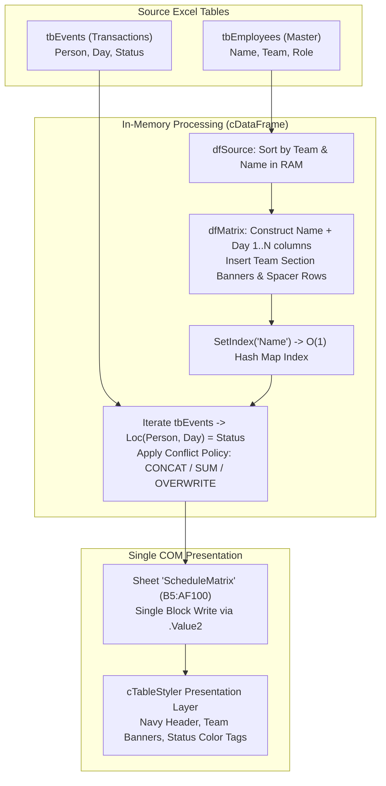

# VBA Matrix Scheduler

> High-performance 2D Schedule & Attendance Matrix Generator for Microsoft Excel VBA.  
> Powered by the In-Memory Columnar DataFrame (`cDataFrame`) Architecture.

---

## 1. Overview

Traditional Excel VBA macros for generating cross-tabulation schedule matrices typically suffer from two major drawbacks:
1. **Slow Cell-by-Cell Worksheet Access**: Looping through rows and columns using `Cells(r, c).Value = ...` creates massive COM interop overhead, taking 10–60+ seconds on realistic enterprise rosters.
2. **Brittle Lookups & Merges**: Using worksheet formulas (`VLOOKUP`, `INDEX/MATCH`) or nested $O(N \times M)$ loops makes handling empty spacer rows, team groupings, and multi-shift conflicts tedious and error-prone.

**`VBA Matrix Scheduler`** solves these challenges by combining:
- **In-Memory Columnar Engine (`cDataFrame` & `cColumn`)**: Performs all sorting, grouping, matrix transformations, and index lookups entirely in RAM.
- **Single COM Read/Write**: Dumps the entire 2D matrix back to the worksheet in a single instantaneous `.Value2` block write (<0.1s).
- **$O(1)$ Hash Matrix Indexing**: Uses `SetIndex` and `Loc(Person, Day)` to map transactions directly to matrix intersections at constant time.
- **Automated Conflict Resolution**: Supports `"CONCAT"` (e.g., combining morning `WFH` and evening `OT` into `"WFH / OT"`), `"SUM"` (for work hours), and `"OVERWRITE"`.
- **Decoupled Styling Engine (`cTableStyler`)**: Beautiful executive theme styling, group banners, weekend/weekday headers, and status color tags.

---

## 2. Architecture & Data Flow



---

## 3. Project Structure

```text
vba-matrix-scheduler/
├── README.md                   # Project documentation & usage guide
├── MatrixScheduler.xlsm        # Ready-to-use interactive Excel demo workbook
├── .gitignore                  # Git ignore rules for Office & temp files
├── src/
│   └── vba/
│       ├── cColumn.cls         # 1D Variant vector store with geometric buffer expansion
│       ├── cDataFrame.cls      # In-memory columnar DataFrame (Loc, SetIndex, Sort, Merge, GroupBy)
│       ├── cTableStyler.cls    # Fluent Excel cell & range styling engine
│       └── mMatrixScheduler.bas# Matrix generation and event mapping workflow
└── scripts/
    └── build_workbook.py       # Automated Python script to build & verify MatrixScheduler.xlsm
```

---

## 4. Quick Start (Using Interactive Demo Workbook)

1. Open `MatrixScheduler.xlsm` in Microsoft Excel.
2. Enable macros when prompted by Excel.
3. On sheet **`ScheduleMatrix`**, you will find 4 action buttons:
   - **`1. Generate Matrix`**: Reads employee records from `tbEmployees`, groups by team, and generates a 30-day schedule grid with styled team headers.
   - **`2. Map Schedule Data`**: Reads transaction records from `tbEvents` and writes status tags into cell intersections with automated color highlighting (`Leave` = Coral, `WFH` = Sky Blue, `OT` = Purple, `Work` = Mint Green).
   - **`Run All (1 + 2)`**: Executes the full end-to-end pipeline in one click.
   - **`Clear Matrix`**: Clears the output matrix range.

---

## 5. Integrating into Existing Workbooks

To integrate this engine into any existing Excel project:

1. Press `ALT + F11` to open the VBA Editor.
2. Right-click your VBA project and choose **Import File...** (`Ctrl + M`).
3. Import the 4 files from `src/vba/`:
   - `cColumn.cls`
   - `cDataFrame.cls`
   - `cTableStyler.cls`
   - `mMatrixScheduler.bas`
4. Call the core procedures directly in your code:

```vb
Sub RunMySchedulePipeline()
    Dim wsEmp As Worksheet, wsMatrix As Worksheet, wsEvents As Worksheet
    Dim tbEmp As ListObject, tbEvents As ListObject
    
    Set wsEmp = ThisWorkbook.Sheets("Employees")
    Set wsEvents = ThisWorkbook.Sheets("Events")
    Set wsMatrix = ThisWorkbook.Sheets("ScheduleMatrix")
    
    Set tbEmp = wsEmp.ListObjects("tbEmployees")
    Set tbEvents = wsEvents.ListObjects("tbEvents")
    
    ' 1. Generate 30-day matrix starting at cell B5
    GenerateMatrixFromTable SourceTable:=tbEmp, _
                            StartCell:=wsMatrix.Range("B5"), _
                            NumDays:=30, _
                            GroupCol:="Team", _
                            NameCol:="Name", _
                            SpacerRows:=True
                            
    ' 2. Map events to cell intersections via RAM
    MapEventsToMatrix EventsTable:=tbEvents, _
                      StartCell:=wsMatrix.Range("B5"), _
                      PersonCol:="Person", _
                      DateCol:="Day", _
                      StatusCol:="Status", _
                      ConflictMode:="CONCAT"
                      
    ' 3. Apply status color tags
    ApplyStatusFormatting wsMatrix.Range("B5")
End Sub
```

---

## 6. License & Credits

- **Author**: Technodevmoo AI Engineering
- **Architecture**: Powered by `cDataFrame` Column-Oriented Table Store
- **License**: MIT
